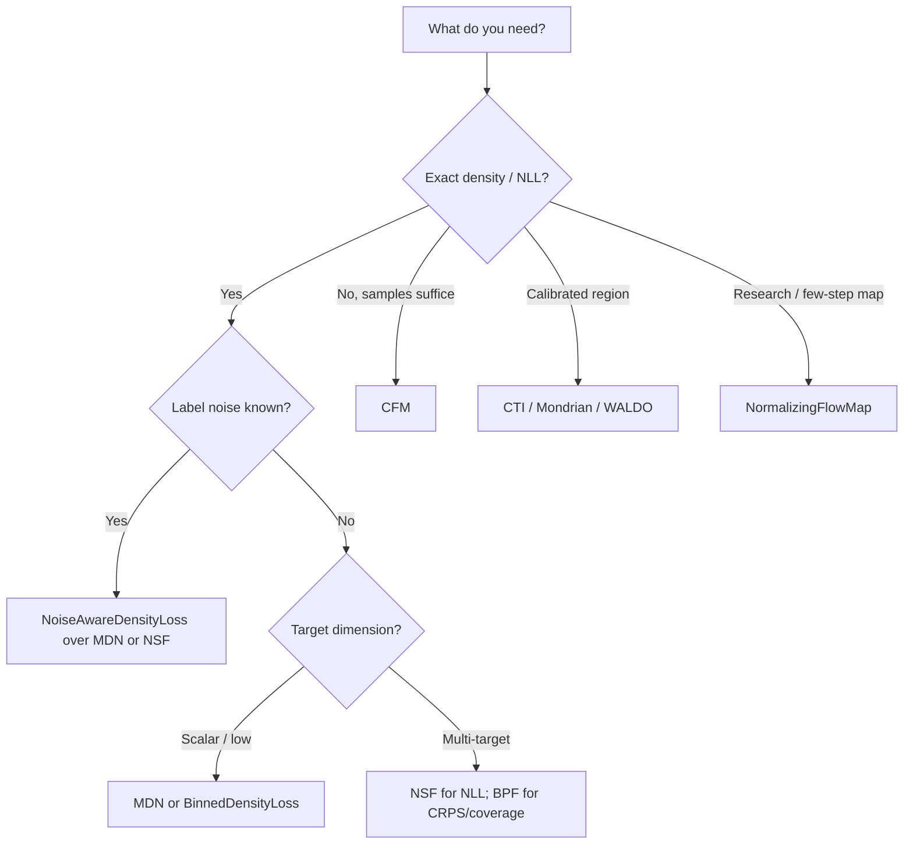

# Conditional Density Estimation: Best Practices and Roadmap

> ← [Best Practices](best-practices.md) | [Multi-Target Regression](multi-target-regression.md) →

This page is the working synthesis of the 2026 density-estimation experiments:
what we would use now, what the evidence supports, and what should be improved
next.  It covers conditional densities $p(y\mid x)$, multi-target distributions,
known label noise, and calibration.  A normalizing flow is a **density engine**;
it is not a fix for imbalance, scarcity, or label noise by itself.

!!! warning "NFM evidence requires a corrected-code rerun"
    NFM likelihood evaluation and sampling previously used endpoint directions
    inconsistent with its noise-to-target training map. Results produced before
    that correction must be rerun before interpreting NLL, sample quality or
    underfitting. Existing artifacts remain historical evidence, not corrected
    measurements. The correction does not change NSF/MAF or default-width CFM.

## Status: what is implemented

| Capability | Public API | Maturity | Use it for |
|:--|:--|:--|:--|
| Mixture density head | [`MDNLoss`](../losses/mdn.md) | Available | Low-dimensional targets; fast, interpretable modes |
| Binned scalar CDF | [`BinnedDensityLoss`](../losses/noise_aware_density.md) | Available | Scalar densities with few labels; robust noise handling |
| Conditional flows | [`NormalizingFlowLoss`](../losses/nflows.md), [`create_flow_model`](../losses/nflows.md) (`nsf`/`maf`/`realnvp`/`cinn`/`bpf`) | Available | Exact conditional likelihood; multimodal tails |
| Conditional flow matching | [`FlowMatchingMLP`](../methods/flow_matching.md), [`cfm_loss`](../methods/flow_matching.md), [`sample_cfm`](../methods/flow_matching.md) | Available | Cheap sample generation; **no exact NLL** |
| Known Gaussian label noise | [`NoiseAwareDensityLoss`](../losses/noise_aware_density.md) over flow/MDN | Available | Measurement-error-aware NLL |
| Binned photo-z recipe | [`PZRecipeLoss`](../losses/photo_z_recipe.md), [`PZRecipe`](../losses/photo_z_recipe.md), [`TriLoss`](../losses/photo_z_recipe.md) | Available | Binned conditional CDF / photo-z challenge reference |
| Contrastive flow / likelihood ratio | [`ContrastiveFlowLoss`](../losses/nflows.md) | Available | Ranking, SBI, likelihood-ratio-style tasks |
| Normalizing Flow Map | [`NormalizingFlowMap`](../methods/normalizing_flow_maps.md) (`arch="coupling"`/`"tarflow"`) | Research | Exact invertible time maps; not a default regression head |
| Density conformal | [`ConformalizedDensity`](../losses/conformal.md), [`ContrastiveFlowConformal`](../losses/conformal.md), [`CTI`](../losses/conformal.md) | Available | Marginal coverage for any density score; Mondrian groups supported |
| WALDO | [`WaldoConformal`](../methods/waldo.md), [`WaldoPosteriorCalibrator`](../methods/waldo.md), [`WaldoDensityConformal`](../methods/waldo.md) | Available | Wald confidence regions from mean/covariance or density samples |

The canonical experiment table, artifacts, and code map live in the sibling
`torchregress-harness` repository at `reports/density_experiments_summary.md`.

## Best practices

### 1. Match the objective to the metric

Use the exact conditional NLL only for models that define a normalized density.
Binned models produce a probability **mass**; its NLL is not comparable with a
continuous flow/MDN NLL.  For sample-only models report CRPS, energy score, and
coverage rather than manufacturing a likelihood.

$$
\mathrm{NLL}=-\frac{1}{N}\sum_{i=1}^{N}\log p(y_i\mid x_i),\qquad
\mathrm{CRPS}(F,y)=\int_{\mathbb R}\big(F(z)-\mathbb 1[z\ge y]\big)^2\,dz.
$$

### 2. Separate model fit from calibration

A well-trained density can still under- or over-cover.  Fit the density on a
training split, calibrate on a held-out split, and report coverage, interval
width and PIT diagnostics alongside NLL/CRPS.  For multi-target calibration use
joint level-set membership or energy scores; per-axis intervals do not imply
joint coverage.

### 3. Be explicit about label noise

`NoiseAwareDensityLoss` assumes a known Gaussian measurement model; it is not a
learned noise detector.  The analytic MDN convolution and the flow marginal
likelihood both improve clean-test NLL but can become overconfident, so re-check
coverage.  If the noise scale is unknown, estimate it from repeats/auxiliary
data rather than fitting it freely with the density.

### 4. Use shared budgets, multiple seeds and robust aggregation

Compare methods with a shared encoder/split/budget.  Flows with affine coupling
can have rare catastrophic tails; report medians and tail diagnostics, not only
means.  A single seed is a screening result, not a ranking.

### 5. Handle multi-target distributions jointly

Correlated targets need joint scores.  Use energy score / variogram score /
joint coverage.  Marginals can look calibrated while the joint region is wrong.
For binned heads, a joint multi-target CDF is still a roadmap item; do not
silently reduce it to independent scalar heads.

### 6. Calibrate with the right guarantee

Split conformal gives **marginal** coverage.  `ConformalizedDensity` and
`ContrastiveFlowConformal` use the density score $s(x,y)=-\log p(y\mid x)$;
Mondrian groups give a coarse conditional improvement.  WALDO's original
conditional guarantee needs simulator draws and quantile-regressed critical
values; `WaldoDensityConformal` is the simulator-free split-conformal adaptation
and should be described as such.

$$
s_i=-\log p(y_i\mid x_i),\qquad
\hat q=\text{the }\left\lceil (n+1)(1-\alpha)\right\rceil\text{-th smallest }s_i.
$$

### 7. Treat NF maps as research until they beat matched baselines

`NormalizingFlowMap` gives exact endpoint likelihood and invertible intermediate
maps, but in our tabular harness it underfit at the standard budget and did not
beat NSF/MDN.  TARFlow-style layers are promising but need a proper architecture
and training budget.  Do not make NFM the default regression head.

### 8. Record compute provenance and negative results

Every report should say CANFAR vs local screen, seeds, epochs, and data version.
Keep failed or skipped runs in the record; a dataset-download timeout is not a
model result.

## Recommended recipes

| Setting | First choice | Strong alternative | Avoid |
|:--|:--|:--|:--|
| Scalar target, small data | MDN or binned CDF | NSF | Starting with a heavy flow |
| Multi-target, NLL matters | NSF | MAF/cINN | CFM for NLL claims |
| Multi-target, CRPS/coverage matters | BPF | NSF | Binned NLL comparisons |
| Known Gaussian label noise | MDN analytic convolution | Noise-aware NSF | Ignoring the measurement model |
| Sampling cost dominates | CFM | MDN sampling | Claiming exact likelihood for CFM |
| Photo-z / binned CDF | PZRecipe + TabM stage 2 | PZRecipe stage 1 | Cross-budget PZ comparisons |
| Need coverage guarantee | CTI / Mondrian conformal | WALDO density regions | Reporting NLL as calibration |
| SBI / ranking | ContrastiveFlow / NRE | NPE | Treating contrastive flow as a calibrated density |
| Research on few-step maps | NFM/TARFlow | CFM distillation | Production default without evidence |

## Roadmap

Priorities are ordered by user impact and evidence gaps.  “Acceptance” means the
item is done only when the code, tests, docs and a harness artifact all exist.

| Priority | Improvement | Why | Acceptance |
|:--|:--|:--|:--|
| **P0** | Complete a real-data NFM/TARFlow run with a cached dataset | Current NFM evidence is synthetic/underfit; the real-data run was blocked by a download timeout | 3 seeds on the density-parity datasets; NLL/CRPS/coverage table; no default claim |
| **P0** | Multi-target binned CDF head | Binned density is currently scalar-only, limiting the noise-robust branch to one target | Joint CDF loss + conditional sampling + tests + harness row |
| **P0** | Mondrian/context-conditional conformal benchmark on CANFAR | The conformal contrastive-flow screen is local/provisional; target-tercile groups are coarse | CANFAR rerun with repeated seeds; conditional coverage by group |
| **P0** | Matched-budget PZRecipe vs NSF comparison | Current PZRecipe/TabM vs flow comparison is cross-budget and historical | Same 16 datasets, seeds, epochs, early stopping; paired table |
| **P1** | WALDO critical-value regression | Simulator-free binned thresholds are approximate; a validated quantile-regression critical-value function would strengthen conditional regions | `critical_value_fn` fitted on calibration features; coverage by parameter region |
| **P1** | Calibrated noise-aware densities | Analytic noise-aware NLL under-covers; calibration layer or temperature is not yet tuned | Coverage restored near nominal with NLL/CRPS reported together |
| **P1** | Stabilize cINN/MAF on hard multi-target data | Rare extreme-transform failures make means unusable | Tail-guard/clipping or residual coupling; failure-rate metric |
| **P1** | Proper multi-target metrics in every suite | Marginal coverage can hide joint failures | Energy/variogram/joint coverage reported by default |
| **P2** | True TARFlow-style tabular transformer | The current TARFlow-lite is per-layer and underfits | Tokenized feature transformer with matched training budget; beats coupling on ≥2 datasets |
| **P2** | Flow-map distillation / few-step NFM | Few-step transport is the main reason to use NFM | Distilled map + sampling-cost/accuracy tradeoff artifact |
| **P2** | Contrastive representation + conditional density | Contrastive flow is strong in SBI but not yet a calibrated regression density | Joint representation/density ablation with conformal coverage |
| **P2** | Semi-supervised / EIV photo-z CDF | Real PZ data have missing labels and noisy features | PZRecipe/flow variants with missing-label and EIV protocols |

## Status update (2026-10-22)

Progress against the P0/P1 roadmap, with evidence:

| Item | Status | Evidence |
|:--|:--|:--|
| Real-data NFM/TARFlow | **Done (NFM), still not competitive** | CANFAR 5 real datasets × 3 seeds, `release_20261022_0749`; worse than NSF/BPF on NLL/CRPS |
| Joint multi-target binned CDF | **Done** | `JointBinnedDensityLoss` + tests; CANFAR noise-aware run `release_20261022_0853` (RMSE 0.712, CRPS 0.411 vs NSF 0.704/0.404; conservative coverage) |
| CANFAR conformal benchmark | **Done** | 2 synthetic datasets × 3 seeds, `release_20261022_0750`; CTI/Mondrian/WALDO coverages near nominal |
| Matched-budget PZRecipe vs NSF | **Running** | CANFAR `release_20261022_0840`, 16 datasets × 3 seeds × 60 epochs; report when complete |
| WALDO critical-value regression | **Done; negative result on small synthetic data** | `WaldoCriticalValueRegressor` + tests; CANFAR `release_20261022_0852` did not improve coverage; keep simple threshold default |
| Calibrated noise-aware densities | Open | Noise-aware NLL still under-covers; needs a proper calibration/temperature study |
| Stabilize cINN/MAF tails | Open | Rare extreme transforms in E2; needs tail guard/failure-rate metric |
| Proper multi-target metrics everywhere | Partial | Joint Cov90, energy, variogram exist in density suites; not all tabular suites use them |

The canonical experiment table and code map live in the sibling harness report
`reports/density_experiments_summary.md`.

## Non-goals

- Do not claim conditional coverage from a marginal split-conformal run.
- Do not compare binned NLL to continuous NLL.
- Do not call CFM an exact-likelihood model.
- Do not present NFM/TARFlow as a production replacement before it beats a
  matched NSF/MDN baseline.
- Do not hide failed runs or cross-budget comparisons.

## References

| # | Reference |
|:-:|:----------|
| 1 | Papamakarios, G. et al. (2021). Normalizing Flows for Probabilistic Modeling and Inference. *JMLR*, 22(57). |
| 2 | Durkan, C., Bekasov, A., Murray, I. & Papamakarios, G. (2019). Neural Spline Flows. *NeurIPS*. |
| 3 | Dinh, L., Sohl-Dickstein, J. & Bengio, S. (2017). Density Estimation Using Real NVP. *ICLR*. |
| 4 | Lipman, Y., Chen, R. T. Q., Ben-Hamu, H., Nickel, M. & Le, M. (2023). Flow Matching for Generative Modeling. *ICLR*. |
| 5 | Masserano, L., Dorigo, T., Izbicki, R., Kuusela, M. & Lee, A. (2023). Simulator-Based Inference with WALDO. *AISTATS*. [arXiv:2205.15680](https://arxiv.org/abs/2205.15680) |
| 6 | Ruscio, F. M. et al. (2026). Normalizing Flow Maps. [arXiv:2610.22711](https://arxiv.org/abs/2610.22711) |
| 7 | Vovk, V., Gammerman, A. & Shafer, G. (2005). *Algorithmic Learning in a Random World*. Springer. |
| 8 | Gneiting, T. & Raftery, A. E. (2007). Strictly Proper Scoring Rules, Prediction, and Estimation. *JASA*, 102(477):359–378. |
