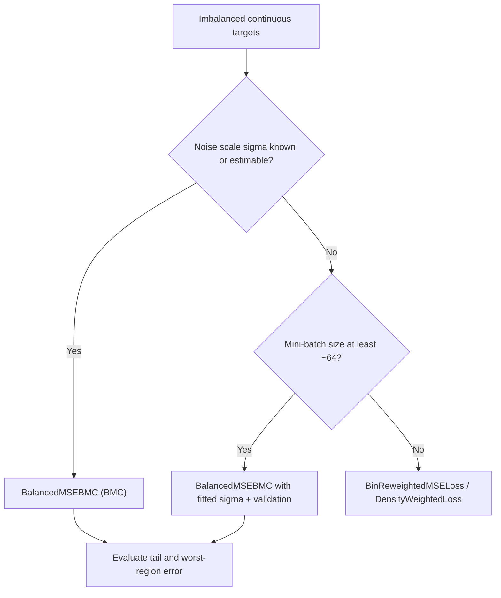

# Balanced MSE (BMC)

> ← [Imbalanced Regression](imbalanced.md) | [Noisy Labels](noisy_labels.md) →

`BalancedMSEBMC` implements the **noise-adaptive Balanced MSE** of Ren et al. (CVPR 2022) using the paper's **Batch-based Monte-Carlo (BMC)** estimator. It is the loss that the historical `BalancedMSELoss` name does **not** implement: `BalancedMSELoss` and `BinReweightedMSELoss` are static inverse bin-frequency reweighting, while BMC compares each prediction against every target in its mini-batch through a temperature-controlled softmax.

!!! warning "Not inverse-frequency weighting"
    If you need per-bin weights `1 / count`, use [`BalancedMSELoss`](imbalanced.md) or
    [`BinReweightedMSELoss`](imbalanced.md). `BalancedMSEBMC` is a different estimator:
    its "balancing" comes from the batch normaliser and the label-noise scale $\sigma$,
    not from fixed sample weights. The class is single-output only; see
    [Caveats](#caveats).

---

## When to use which

| Situation | Prefer |
|:----------|:-------|
| Imbalanced continuous targets, label noise is known or can be estimated, mini-batches of at least ~64 samples | **`BalancedMSEBMC`** |
| Simple inverse-frequency reweighting, no noise scale, multi-output targets, batch-size-independent loss | [`BalancedMSELoss`](imbalanced.md) / [`BinReweightedMSELoss`](imbalanced.md) |
| Calibration-safe density reweighting with a KDE prior, including multi-output targets | [`DensityWeightedLoss`](imbalanced.md) |
| Very small batches or streaming/online training where a batch-coupled loss is impractical | A per-sample reweighting loss ([`BinReweightedMSELoss`](imbalanced.md), [`DensityWeightedLoss`](imbalanced.md)) |
| A calibrated predictive distribution rather than a point-regression training objective | [`GaussianNLLLoss`](gaussian.md) plus post-hoc calibration |



---

## Mathematical definition

### Balanced MSE

Write the balanced predictive distribution as
$p_{\text{bal}}(y \mid x) = \mathcal{N}\!\left(y; f(x), \sigma^2\right)$
and the training label prior as $p(y)$. Bayes' rule with the assumption that
$p_{\text{train}}(x \mid y) = p_{\text{bal}}(x \mid y)$ gives the statistical conversion

$$
p_{\text{train}}(y \mid x)
=
\frac{p_{\text{bal}}(y \mid x)\, p(y)}
     {\int p_{\text{bal}}(y' \mid x)\, p(y')\, \mathrm{d}y'}.
$$

Balanced MSE is the negative log-likelihood of this converted distribution. For a
sample $(x_i, y_i)$ with prediction $f_i = f(x_i)$,

$$
L_i
=
-\log p(y_i)
+
\frac{(y_i - f_i)^2}{2\sigma^2}
+
\log \int \mathcal{N}\!\left(y'; f_i, \sigma^2\right) p(y')\, \mathrm{d}y'
+
\text{const},
$$

where the Gaussian normalisation constants cancel because they are identical in the
numerator and the integral. The paper treats $-\log p(y_i)$ as a constant because it
does not depend on the model parameters; the implementation keeps it so that the
reported loss is the prior-weighted negative log posterior. A uniform prior makes
every $\log p$ term vanish and recovers the paper's BMC loss exactly.

### Batch-based Monte Carlo (BMC)

The integral is approximated on the current target batch
$B_y = \{y_1, \dots, y_B\}$ by treating the batch as a discrete support for the label
prior, with atom masses proportional to $p(y_j)$:

$$
L_i
=
-\log p(y_i)
+
\frac{(y_i - f_i)^2}{2\sigma^2}
+
\log \sum_{j=1}^{B} p(y_j)
\exp\!\left(
-\frac{(f_i - y_j)^2}{2\sigma^2}
\right).
$$

Equivalently, the batch-normalised posterior is
$p(y_i \mid x_i) \approx
p(y_i)e^{-(y_i-f_i)^2/(2\sigma^2)}
\big/
\sum_j p(y_j)e^{-(f_i-y_j)^2/(2\sigma^2)}$,
and $L_i$ is its negative logarithm.

For a uniform prior, $p(y_j)$ is constant, so it cancels between the numerator and the
sum. With the temperature $\tau = 2\sigma^2$ this is the paper's Eq. (3.14):

$$
L_i
=
\frac{(y_i - f_i)^2}{2\sigma^2}
+
\log \sum_{j=1}^{B}
\exp\!\left(
-\frac{(f_i - y_j)^2}{2\sigma^2}
\right)
=
-\log
\frac{\exp\!\left(-(f_i-y_i)^2/\tau\right)}
     {\sum_j \exp\!\left(-(f_i-y_j)^2/\tau\right)}.
$$

`BalancedMSEBMC(prior="uniform")` computes exactly this softmax expression.

!!! info "What the batch normaliser does"
    A sample whose target lies in a dense region has many neighbours in the batch, so
    its softmax denominator is large and its loss is comparatively small. A rare
    target has few neighbours, so its denominator is small and its loss is larger.
    Minimising the average loss therefore allocates capacity to rare targets instead
    of only improving the average fit in the dense region.

!!! warning "Prior-weighted vs. original BMC"
    The formula above uses the batch as a **discrete support with masses
    $p(y_j)$**, which is the prior-weighted BMC variant implemented here. The
    paper's original BMC draws an unweighted Monte Carlo sample from the *training*
    label distribution and uses equal weights; that estimator is recovered with
    `prior="uniform"`. Using the fitted prior weights is appropriate when the batch
    is a support sample for the prior (for example a stratified or otherwise
    non-representative batch). If your mini-batches are i.i.d. draws from
    $p_{\text{train}}(y)$, compare both settings on held-out data.

---

## Algorithm

1. **Fit the label prior** — call `fit(train_targets)` once before training:
   - `prior="histogram"` (default): equal-width histogram with boundary-reflected
     Gaussian smoothing and interpolation of the log density at bin centres;
     outside the fitted range the edge density is held constant.
   - `prior="kde"`: Gaussian kernel density estimate with Silverman's rule (or an
     explicit `prior_bandwidth`). The reference set is deterministically subsampled
     to `kde_points` points to bound memory.
   - `prior="uniform"`: no label prior; the loss is the paper's BMC.
2. **Choose the noise scale** $\sigma$:
   - pass `sigma=...` when the label-noise scale is known;
   - otherwise `fit` uses a robust median-absolute-deviation estimate from the
     residuals if you pass `train_predictions=...` (use out-of-sample or
     cross-fitted predictions; in-sample residuals underestimate the noise);
   - with only `train_targets`, it falls back to the robust scale of the marginal
     target distribution. This is a **target-scale proxy**, not identifiable label
     noise — see [Caveats](#caveats).
3. **Per batch**, compute the logits
   $\log p(y_j) - (f_i-y_j)^2/(2\sigma^2)$, the row-wise
   $\operatorname{logsumexp}$, and the per-sample loss. Then apply the shared
   reduction, mask, and sample-weight contract.

!!! info "fit is recommended"
    If `forward` is called before `fit`, the loss falls back to the paper's
    uniform-prior BMC with the supplied `sigma` (or `sigma=1.0`) and emits a
    `UserWarning`. `prior="uniform"` with an explicit `sigma` is fully usable
    without fitting; the fitted-prior and automatic-`sigma` paths require
    `fit`.

Masked targets are removed from the batch support (their log-prior column is
$-\infty$), not merely zeroed after the reduction. A masked row therefore changes
the loss of the remaining samples; this is the statistically consistent treatment of
missing labels in a batch-coupled loss.

!!! info "Loss scale vs. the official reference code"
    This implementation returns the raw BMC negative log-likelihood of the paper
    (with the cancelling Gaussian constants omitted). The official
    `BMCLossMD` reference code multiplies the cross-entropy by
    $(2\sigma^2).\text{detach}()$ to put the value on an MSE-like scale. That
    factor does not change the minimiser for fixed $\sigma$, but it does change
    gradient magnitudes and therefore optimizer behaviour. Multiply this loss by
    $2\sigma^2$ externally if you need parity with that code.

---

## API

```python
from torchregress.losses import BalancedMSEBMC

loss_fn = BalancedMSEBMC(
    sigma=None,             # None -> robust fit-time estimate
    prior="histogram",      # "histogram" | "kde" | "uniform"
    num_bins=64,
    prior_bandwidth=None,   # None -> 1.5 bin widths (histogram) / Silverman (KDE)
    kde_points=2048,
    prior_floor=1e-6,       # density floor as a fraction of the maximum
    min_sigma=1e-6,
    reduction="mean",
).fit(train_targets)

loss = loss_fn(model(x_batch), y_batch, mask=mask, weights=weights)
```

`create_loss_from_config({"type": "balanced_mse_bmc", ...})` constructs the loss from a
config dictionary. The fitted prior is a module buffer and follows `.to(device)`.

| Parameter | Type | Default | Description |
|:----------|:-----|:--------|:------------|
| `sigma` | `float \| None` | `None` | Label-noise standard deviation; `None` estimates it in `fit`. |
| `prior` | `str` | `"histogram"` | `"histogram"`, `"kde"`, or `"uniform"`. |
| `num_bins` | `int` | `64` | Histogram bins (at least 2). |
| `prior_bandwidth` | `float \| None` | `None` | Smoothing bandwidth in target units. |
| `kde_points` | `int` | `2048` | Maximum KDE reference points. |
| `prior_floor` | `float` | `1e-6` | Density floor as a fraction of the maximum, in `(0, 1]`. |
| `min_sigma` | `float` | `1e-6` | Lower bound for an estimated `sigma`. |
| `reduction` | `str` | `"mean"` | `"mean"`, `"sum"`, or `"none"`. |

Functional form for an external prior:

```python
from torchregress.losses.balanced_mse_bmc import balanced_mse_bmc_loss

loss = balanced_mse_bmc_loss(
    y_pred, target, log_prior, sigma, mask=mask, weights=weights, reduction="mean"
)
```

`log_prior` is `log p(y_j)` for the batch targets (zeros for a uniform prior).
`loss_fn.log_prior(y)` evaluates the fitted prior for diagnostics.

---

## Runnable example

The example trains the same linear model on the same imbalanced data twice: once
with MSE and once with BMC. The training labels are a truncated normal concentrated
around 5; the evaluation grid is uniform on $[0, 10]$, the paper's balanced test
distribution. `sigma=1.0` is the known noise scale.

```python
import torch
from torchregress.losses import BalancedMSEBMC

# 1. Imbalanced 1-D regression: labels ~ N(5, 0.5) truncated to [0, 10],
#    then inputs are generated as x = y - noise so the oracle is y = x.
generator = torch.Generator().manual_seed(0)
n = 512
y = 5.0 + 0.5 * torch.randn(n, generator=generator)
y = y[(y >= 0.0) & (y <= 10.0)]
while y.numel() < n:
    extra = 5.0 + 0.5 * torch.randn(n, generator=generator)
    y = torch.cat([y, extra[(extra >= 0.0) & (extra <= 10.0)]])
y = y[:n]
x = (y - torch.randn(n, generator=generator)).unsqueeze(-1)
y = y.unsqueeze(-1)

# 2. Fit the label prior once. sigma is the known label-noise scale here;
#    omit it to use the robust fit-time estimator.
bmc = BalancedMSEBMC(sigma=1.0, prior="histogram", num_bins=64).fit(y)
mse = torch.nn.MSELoss()


def train(loss_fn: torch.nn.Module, epochs: int = 50) -> torch.nn.Linear:
    model = torch.nn.Linear(1, 1)
    with torch.no_grad():
        model.weight.zero_()
        model.bias.zero_()
    optimizer = torch.optim.SGD(model.parameters(), lr=1e-3, momentum=0.9)
    order = torch.Generator().manual_seed(1)
    for _ in range(epochs):
        permutation = torch.randperm(n, generator=order)
        for start in range(0, n, 128):
            idx = permutation[start : start + 128]
            optimizer.zero_grad()
            loss = loss_fn(model(x[idx]).flatten(), y.flatten()[idx])
            loss.backward()
            optimizer.step()
    return model.eval()


def regional_mse(model: torch.nn.Module) -> dict[str, float]:
    grid = torch.linspace(0.0, 10.0, 512)
    with torch.no_grad():
        prediction = model(grid.unsqueeze(-1)).flatten()
    error = (prediction - grid) ** 2
    tail = (grid < 1.0) | (grid > 9.0)
    return {
        "all": error.mean().item(),
        "tail": error[tail].mean().item(),
        "worst": error.max().item(),
    }


for name, loss_fn in [("MSE", mse), ("BalancedMSEBMC", bmc)]:
    scores = regional_mse(train(loss_fn))
    print(
        f"{name:>14}: all={scores['all']:.4f}  "
        f"tail={scores['tail']:.4f}  worst={scores['worst']:.4f}"
    )
```

Verified output:

| Method | All-grid MSE | Tail MSE ($x<1$ or $x>9$) | Worst-point MSE |
|:-------|-------------:|--------------------------:|----------------:|
| MSE | 0.3578 | 0.8387 | 1.3228 |
| `BalancedMSEBMC` | **0.0892** | **0.0989** | **0.1843** |

The gap is large in this deliberately extrapolatory benchmark; on real data expect a
smaller but still meaningful tail/worst-region trade-off. Always compare both methods
with the same model, optimizer, batch size, and training budget.

---

## Comparison with the other "balanced" losses

| Aspect | `BalancedMSELoss` / `BinReweightedMSELoss` | `BalancedMSEBMC` |
|:-------|:-------------------------------------------|:-----------------|
| Mechanism | Static per-bin inverse-frequency sample weights | Batch softmax over candidate targets; noise-adaptive |
| Noise model | None | Gaussian label noise with scale $\sigma$ |
| `fit` estimates | Bin edges/counts | Label prior and (if needed) $\sigma$ |
| Batch-size dependence | None | Yes, through the Monte Carlo normaliser |
| Multi-output | Bin assignment uses the mean coordinate; squared error is elementwise | Rejected explicitly (scalar targets only) |
| Main reference | Delving into Deep Imbalanced Regression (Yang et al., 2021) | Balanced MSE (Ren et al., CVPR 2022) |
| Typical role | Cheap baseline reweighting | Tail-focused objective when the noise scale is meaningful |

The inverse-frequency losses remain useful baselines: they are cheaper, batch-size
independent, and work with multi-output targets. BMC is the better match when the
imbalance is severe, the label noise scale can be estimated, and tail or worst-region
error is the quantity you care about.

---

## Caveats

1. **Batch-size dependence.** The normaliser is a Monte Carlo estimate over the
   current batch. Loss values are not comparable across batch sizes, and small
   batches give a high-variance estimate. The paper uses batch size 256 in its
   synthetic benchmark; use at least ~64 when possible.
2. **Automatic `sigma` is a proxy.** With only `train_targets`, label noise and
   signal variation are not identifiable. `fit` then uses the robust marginal scale
   of the targets, which is generally an upper-bound-style heuristic, not the noise
   standard deviation. Pass `sigma=` or `train_predictions=` for a genuine
   noise-adaptive estimate.
3. **Deviation from the paper's `sigma` procedure.** The paper makes `sigma` a single
   learnable parameter optimized jointly with the model (Appendix B.5) and
   initializes it near the true noise scale. It does **not** select `sigma` by a
   minimum-variance-over-batch-sizes search. This implementation uses a one-shot
   robust MAD estimate instead: it avoids adding `sigma` to the optimizer but is not
   end-to-end optimal. Supplying `sigma` is the closest match to the paper's
   "true noise scale" experiments.
4. **Prior weighting assumption.** The fitted prior enters both the numerator and
   the batch normaliser as a discrete support. For mini-batches that are i.i.d. draws
   from the training distribution, the paper's unweighted Monte Carlo estimator is
   `prior="uniform"`. Compare `"uniform"`, `"histogram"`, and `"kde"` on held-out
   data; do not assume the prior-weighted form is always better.
5. **Single-output only.** Multi-output targets raise `ValueError` rather than
   silently averaging coordinates. Train one loss per coordinate with its own prior
   and $\sigma$, or use the paper's GMM-based analytical option for a joint
   multivariate objective.
6. **Memory and compute.** The pairwise logit matrix is $O(B^2)$ per batch; the KDE
   prior adds $O(B \times \texttt{kde\_points})$ work per forward. The histogram prior
   is $O(B)$ after fitting.
7. **Not a calibrated predictive distribution.** BMC is a training objective. It does
   not produce intervals or a normalised predictive density. Validate calibration,
   coverage, and tail metrics on held-out data; see the
   [imbalanced-regression guide](imbalanced.md) and [conformal prediction](conformal.md)
   for downstream uncertainty tools.
8. **Prior floor and extrapolation.** Empty histogram bins and far KDE tails are
   floored at `prior_floor` times the maximum density. This keeps the loss finite but
   makes the prior outside the training range a modelling choice. Ensure the training
   targets cover the range you care about, and inspect `loss_fn.log_prior(...)` when
   in doubt.

---

## Next steps

- [Imbalanced regression](imbalanced.md) — reweighting, LDS, density weighting, and Focal-R
- [Noisy labels](noisy_labels.md) — target-noise models and robust likelihoods
- [Base classes](base.md) — reduction, mask, and sample-weight contract
- [Loss API](../api/losses.md) — constructor signatures
- [Tail metrics](../metrics/point.md#tail-metrics) — evaluate the worst regions explicitly

---

## References

| # | Reference |
|:-:|:----------|
| 1 | J. Ren, M. Zhang, C. Yu, Z. Liu. ["Balanced MSE for Imbalanced Visual Regression."](https://arxiv.org/abs/2203.16427) *CVPR*, **2022**. |
| 2 | Y. Yang, K. Zha, Y. Chen, H. Wang, D. Katabi. ["Delving into Deep Imbalanced Regression."](https://arxiv.org/abs/2102.09554) *ICML*, **2021**. |
| 3 | M. Steininger, K. Kobs, P. Padberg, A. Hotho. ["Density-based weighting for imbalanced regression."](https://doi.org/10.1007/s10994-021-06024-2) *Machine Learning*, 110(8):2187–2209, **2021**. |
