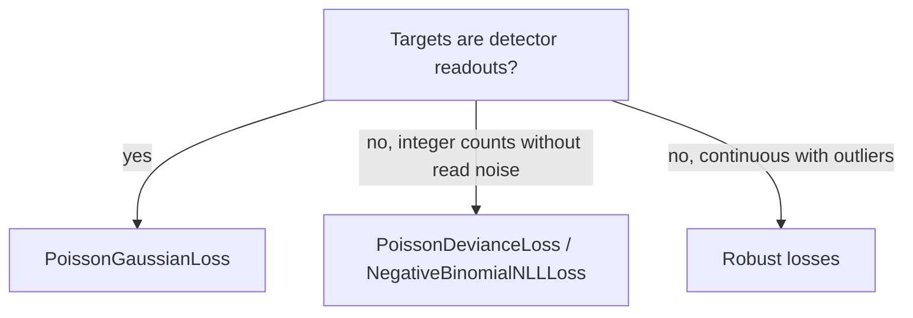

# Poisson-Gaussian Losses

> ← [Poisson & Tweedie](poisson_tweedie.md) | [Evidential Regression](advanced.md) →

Two different likelihoods are called "Poisson-Gaussian". This page covers both
and says which one to use.

| Loss | Model | Use for |
|:-----|:------|:--------|
| `PoissonGaussianLoss` | Convolution: a Poisson count read out with additive Gaussian noise | Detector data: shot noise plus read noise (CCD/CMOS, photon counting, microscopy, low-dose imaging) |
| `PoissonGaussianContaminationMixtureLoss` | Two-component mixture: each sample is Poisson *or* Gaussian | Not a detector model; see [Mixture losses](#mixture-losses) |
| `EnhancedPoissonGaussianContaminationMixtureLoss` | Same mixture with gain, offset and a signal-dependent Gaussian variance | Not a detector model; see [Mixture losses](#mixture-losses) |
| `PoissonGaussianLikelihoodRatioLoss` | Average of a Poisson deviance and a scaled squared error | Not a likelihood of either model |

!!! tip "API reference"
    See [`PoissonGaussianLoss`](../api/losses.md) and the other classes in the
    API reference for full signatures.

## Detector model: `PoissonGaussianLoss`

A detector counts $K$ photo-electrons, multiplies them by a gain $g$, adds an
offset $b$ and adds Gaussian read noise:

$$K \sim \text{Poisson}(\lambda), \qquad y = g\,K + b + \varepsilon, \qquad \varepsilon \sim \mathcal{N}(0, \sigma^2).$$

The density of the measured value is the convolution of the two laws:

$$p(y \mid \lambda) = \sum_{k=0}^{\infty} \frac{\lambda^k e^{-\lambda}}{k!}\;\mathcal{N}\!\left(y;\; g\,k + b,\; \sigma^2\right),
\qquad \mathcal{L}(\lambda; y) = -\log p(y \mid \lambda).$$

$\lambda$ is the expected count (the model output, or $\log\lambda$ with
`log_input=True`), $g$ is in output units per count, $b$ is a signed offset
(bias or background in output units) and $\sigma^2$ is the read-noise variance
in output units squared. The target $y$ is in output units and can be
non-integer or negative.

Two limits fix the scale of the loss:

- **High counts.** $p(y \mid \lambda) \to \mathcal{N}(y;\, g\lambda + b,\, g^2\lambda + \sigma^2)$.
  The leading correction is the skewness term $\tfrac{\gamma}{6}\,\mathrm{He}_3(z)$
  with $\gamma = g^3\lambda / (g^2\lambda+\sigma^2)^{3/2} \approx 1/\sqrt{\lambda}$.
- **No read noise.** With $g = 1$, $b = 0$ and $\sigma \to 0$, integer targets
  give $-\log \text{Poisson}(y;\lambda)$ plus the constant $\tfrac12\log(2\pi\sigma^2)$.

### How the sum is evaluated

- **Finite support.** For each element the sum runs over a count window that
  keeps at least `tail_sigma` (default 12) standard deviations of the Poisson
  prior, $\lambda \pm (t\sqrt{\lambda+1} + t^2)$, merged with a window of the same
  radius around the mode of the posterior $\Pr(k \mid y)$. The weights are
  renormalised over the window, so the result is a normalised density.
- **Outliers.** A target far from $g\lambda + b$ has a posterior window disjoint
  from the prior window. It is scored on its own window with the exact,
  unrenormalised Poisson pmf, so the loss keeps growing instead of saturating.
- **Bounded memory.** Elements are processed in chunks of about $2^{22}$ count
  terms. First derivatives are posterior moments, e.g.
  $\partial\mathcal{L}/\partial b = -\mathbb{E}[y - gk - b \mid y]/\sigma^2$, so the
  backward pass stores O(batch) tensors. Second derivatives
  (`create_graph=True`) recompute through a differentiable log-sum-exp.
- **Fail closed.** Negative or non-finite rates, non-positive gain or read-noise
  variance, and non-finite targets raise `ValueError`. Masked entries may hold
  NaN. A window wider than `max_terms` (default 4096, reached near
  $\lambda \approx 2\times10^4$) raises; use the Gaussian limit there.

The algorithm follows `poisson_gaussian_nll` in torchsky. That version also
provides a CDF, forward-mode AD, second-order rate derivatives at
$\lambda = 0$ and well-conditioned curvature at tiny rates in float32; these are
not in torchregress.

### Parameters

- `gain`, `offset`, `read_noise_variance` (float): detector constants. Defaults `1.0`, `0.0`, `1.0`.
- `learn_gain`, `learn_offset`, `learn_read_noise` (bool): learn $\log g$, $b$, $\log\sigma^2$, initialised at the values above. Default `False`.
- `log_input` (bool): `y_pred` is $\log\lambda$. Default `False`.
- `tail_sigma` (float): support radius in standard deviations. Default `12.0`.
- `max_terms` (int): largest allowed count window. Default `4096`.
- `reduction`: `'mean'` | `'sum'` | `'none'`.

`forward(y_pred, target, gain=None, offset=None, read_noise_variance=None, mask=None, weights=None)`
takes optional per-element calibration maps that replace the module values for
that call. As with the other losses, extra arguments come before `mask` and
`weights`; pass them, and `mask`/`weights`, by keyword.

### Example

```python
import math

import torch
from torch import nn

import torchregress as tr

torch.manual_seed(0)
gain, offset, read_var = 2.0, 100.0, 9.0  # ADU per electron, bias in ADU, ADU^2

# Simulated detector: a rate that depends on x, low counts, strong read noise.
x = torch.rand(2000, 1) * 3
rate = torch.exp(0.8 * x - 0.5)
counts = torch.poisson(rate)
y = gain * counts + offset + math.sqrt(read_var) * torch.randn_like(rate)

model = nn.Sequential(nn.Linear(1, 32), nn.Tanh(), nn.Linear(32, 1))  # predicts log rate
loss_fn = tr.losses.PoissonGaussianLoss(
    gain=gain, offset=offset, read_noise_variance=read_var, log_input=True
)
opt = torch.optim.Adam(model.parameters(), lr=1e-2)
for _ in range(300):
    opt.zero_grad()
    loss = loss_fn(model(x), y)
    loss.backward()
    opt.step()

print(f"final NLL {loss.item():.3f}")
```

To estimate the read noise from data as well, pass `learn_read_noise=True` and
add `loss_fn.parameters()` to the optimiser.

## Mixture losses

`PoissonGaussianContaminationMixtureLoss` computes

$$\mathcal{L}(\lambda; y) = -\log\!\Big(w\,\text{Pois}(y;\lambda) + (1-w)\,\mathcal{N}(y;\lambda,\sigma^2)\Big),$$

with the Poisson term from `torch.nn.PoissonNLLLoss(full=True)`. It is a
two-component mixture: each sample comes from *one* of the two laws.
`EnhancedPoissonGaussianContaminationMixtureLoss` uses the same form with equal weights,
$\mu = g\lambda + b$ in both components and a Gaussian variance
$\sigma_1^2 + \sigma_2^2\,\mu$.

!!! warning "These are not the detector model"
    Shot noise plus read noise is the convolution above, not a mixture. The
    mixture also evaluates a Poisson pmf on continuous, possibly negative
    targets, where it is not a density. For any negative target the Poisson
    term $\lambda - y\log\lambda$ goes to $-\infty$ as $\lambda \to 0$, so the
    loss is unbounded below at low counts.

A two-component mixture is the right form for contamination, where a fraction
of samples follow a different law (Huber's $\varepsilon$-contamination). These
two classes give both components the same location $\lambda$, so they do not
down-weight outliers either.

Simulated detector data ($g = 1$, $b = 0$; 25 pixels per fit, 300 fits; rate
estimated by maximum likelihood; coverage of the 95% profile-likelihood
interval):

| $\lambda$, $\sigma^2$ | `PoissonGaussianLoss` bias / coverage | `PoissonGaussianContaminationMixtureLoss` bias / coverage | Enhanced (`shot_noise=1`) bias / coverage |
|:--|:--|:--|:--|
| 0.5, 4 | +3% / 0.97 | estimate collapses to 0 / 0.00 | collapses to 0 / 0.00 |
| 2, 4 | +2% / 0.94 | −71% / 0.14 | −70% / 0.18 |
| 10, 9 | +0.4% / 0.96 | +0.3% / 0.84 | +1.2% / 0.93 |
| 1000, 25 | +0.04% / 0.95 | +0.08% / 0.61 (estimator sd 1.6×) | +0.04% / 0.95 |

At high counts the enhanced mixture with `shot_noise = g` matches the Gaussian
limit because its Gaussian component is $\mathcal{N}(g\lambda, g^2\lambda+\sigma^2)$
and the Poisson component is negligible. With 10% broad outliers added, every
loss in the table is biased by several standard errors.

### Parameters

`PoissonGaussianContaminationMixtureLoss`:

- `eps` (float): numerical floor. Default `1e-8`.
- `learn_variance` (bool), `initial_variance` (float), `min_variance` (float): Gaussian variance $\sigma^2$.
- `log_input` (bool): `y_pred` is $\log\lambda$. Default `False`.
- `mixture_weights`: weight $w$ of the Poisson component; `None` (0.5), a float, or `'learn'`.
- `extra_variance_model` (bool): add the `extra_var` forward argument to $\sigma^2$. Note that `extra_var` is the **third positional** parameter of `forward(y_pred, target, extra_var=None, mask=None, weights=None)`.

`EnhancedPoissonGaussianContaminationMixtureLoss`:

- `gain`, `offset`, `read_noise` ($\sigma_1^2$), `shot_noise` ($\sigma_2^2$): floats or `'learn'`.
- `log_input` (bool), `calibration` (bool, adds a learnable affine map on $\lambda$).

```python
import torch

import torchregress as tr

y_pred = torch.log(torch.tensor([[10.0, 20.0], [5.0, 15.0]]))
target = torch.tensor([[11.2, 19.5], [4.8, 16.3]])

mixture = tr.losses.PoissonGaussianContaminationMixtureLoss(initial_variance=0.1, log_input=True)
enhanced = tr.losses.EnhancedPoissonGaussianContaminationMixtureLoss(
    gain=1.0, read_noise=0.1, shot_noise=1.0, log_input=True
)
print(mixture(y_pred, target), enhanced(y_pred, target))
```

## Likelihood-ratio loss

`PoissonGaussianLikelihoodRatioLoss` returns
$\tfrac12\big(D_{\text{Pois}}(y,\lambda) + (y-\lambda)^2/\sigma^2\big)$, the mean
of a Poisson likelihood-ratio deviance and a scaled squared error. It is a
heuristic score, not the likelihood of either model above.

## When to use which



| Situation | Loss |
|:----------|:-----|
| Shot noise plus read noise, any count level | `PoissonGaussianLoss` |
| Very high counts ($\lambda \gtrsim 2\times10^4$) | Gaussian NLL with variance $g^2\lambda+\sigma^2$ |
| Pure counts, no read noise | `PoissonDevianceLoss`, `NegativeBinomialNLLLoss` ([Poisson & Tweedie](poisson_tweedie.md)) |
| Outlier contamination | [Robust losses](robust.md) |

!!! info "Gain and offset identifiability"
    With learnable gain and offset, $g$, $b$ and the scale of $\lambda$ trade
    off against each other unless the rate is anchored, e.g. by a fixed gain from
    a photon-transfer curve or by bias frames for $b$.

## Next steps

- [Poisson & Tweedie](poisson_tweedie.md) — count models without read noise
- [Gaussian losses](gaussian.md) — the high-count limit
- [Transform losses](transforms.md) — variance-stabilising transforms (Anscombe) as an alternative
- [Poisson-Gaussian example](../examples/poisson_gaussian_contamination_mixture.md) — runnable demo of the mixture losses

---

## References

| # | Reference |
|:-:|:----------|
| 1 | D.L. Snyder, A.M. Hammoud, R.L. White. ["Image recovery from data acquired with a charge-coupled-device camera."](https://doi.org/10.1364/JOSAA.10.001014) *J. Opt. Soc. Am. A*, 10(5):1014–1023, **1993**. |
| 2 | J. Seifert et al. ["Maximum-likelihood estimation in ptychography in the presence of Poisson-Gaussian noise statistics."](https://arxiv.org/abs/2308.02436) *Optics Letters*, 48(22):6027–6030, **2023**. |
| 3 | A. Foi, M. Trimeche, V. Katkovnik, K. Egiazarian. ["Practical Poissonian-Gaussian Noise Modeling and Fitting for Single-Image Raw-Data."](https://doi.org/10.1109/TIP.2008.2001399) *IEEE Trans. Image Process.*, 17(10):1737–1754, **2008**. |
| 4 | P.J. Huber. ["Robust estimation of a location parameter."](https://doi.org/10.1214/aoms/1177703732) *Ann. Math. Statist.*, 35(1):73–101, **1964**. |
| 5 | G.J. McLachlan, D. Peel. [*Finite Mixture Models.*](https://doi.org/10.1002/0471721182) Wiley, **2000**. |
