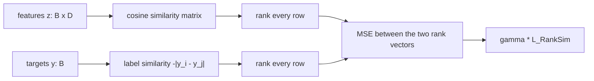
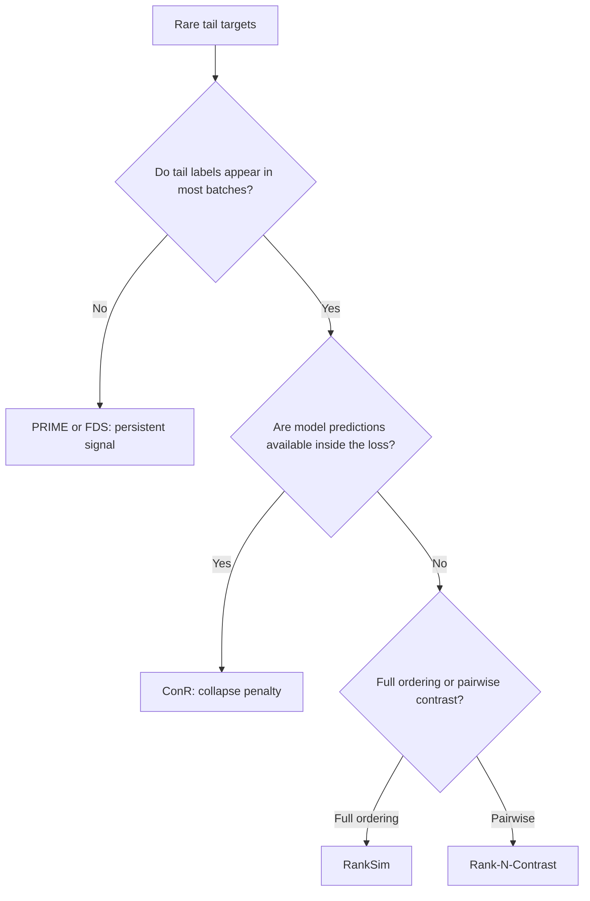

# RankSim: Ranking Similarity Regularization

> ← [Imbalanced targets](imbalanced.md) | [PRIME & ConR](prime_conr.md) →

Long-tailed regression is not only an output-space reweighting problem. A network trained with a pointwise loss can learn a **feature space in which rare targets are absorbed by the well-populated bulk**: the few metal-poor stars, young ages, or extreme-depth pixels end up close to majority features even though their labels are far away.

**RankSim** (Gong, Mori & Tung, ICML 2022) attacks this directly. For every anchor it compares two sorted lists — the other samples ordered by **label distance** and the same samples ordered by **feature similarity** — and penalises any disagreement between the two rankings. The regularizer is parameter-free, needs no model predictions, and is orthogonal to reweighting (LDS, density weighting, Balanced MSE) and to distribution smoothing (FDS).

!!! abstract "The idea in one sentence"
    Samples that are closer in label space should also be closer in feature space — not just locally (FDS), and not just pairwise (Rank-N-Contrast), but as a **complete ordering** of every anchor's neighbours.

---

## Pipeline



The term is added to a task regression loss; the encoder receives gradients from both terms in a single backward pass.

---

## Mathematical definition

Let $z_i = f_\theta(x_i) \in \mathbb{R}^D$ be the feature vector of sample $i$ and $y_i \in \mathbb{R}$ its scalar target. For an anchor $i$, define the **competition rank** of a score vector $\mathbf a \in \mathbb{R}^M$ as

$$
\operatorname{rk}(\mathbf a)_j = 1 + \left|\{k : a_k > a_j\}\right|,
\qquad
\tilde{\operatorname{rk}}(\mathbf a)_j = \frac{\operatorname{rk}(\mathbf a)_j}{M},
$$

so the largest score receives rank $1$ and equal scores receive equal ranks. The label-space and feature-space similarities are

$$
S^{y}_{ij} = -\,\lvert y_i - y_j\rvert,
\qquad
S^{z}_{ij} = \sigma^{z}(z_i, z_j) = \frac{z_i^\top z_j}{\lVert z_i\rVert\,\lVert z_j\rVert},
$$

where the cosine similarity is the paper's default and an L2 option is also available. The per-anchor rank-matching loss and the regularizer are

$$
\ell_i = \frac{1}{M}\sum_{j=1}^{M}\left(\tilde{\operatorname{rk}}(S^{z}_{i,:})_j - \tilde{\operatorname{rk}}(S^{y}_{i,:})_j\right)^2,
\qquad
\mathcal{L}_{\text{RankSim}} = \sum_{i=1}^{M}\ell_i,
$$

which is Eq. (4) of Gong et al. (2022) with the ranks normalised by $M$ (as in the reference implementation). Minimising $\ell_i$ maximises the Spearman correlation between the label and feature rankings of anchor $i$.

!!! info "Mean versus sum"
    Eq. (4) is a **sum** over anchors. `RankSimLoss(reduction="mean")` (the default) returns the per-anchor average $\frac{1}{M}\sum_i \ell_i$, which keeps the regularizer on the same scale as an average task loss. The two differ by a factor of $M$ (the number of distinct targets in the batch). Use `reduction="sum"` to reproduce Eq. (4) exactly, or scale the balancing weight by $M$ when using the mean.

### Differentiating through the ranking

Ranking is piecewise constant, so its true gradient is zero almost everywhere. RankSim uses the continuous interpolation of Vlastelica et al. (2020). With $\lambda>0$ the interpolation strength and $g = \partial \mathcal{L}/\partial \operatorname{rk}(S^z)$ the incoming gradient,

$$
\frac{\partial \mathcal{L}}{\partial S^{z}}
= -\frac{1}{\lambda}\left(\operatorname{rk}(S^{z}) - \operatorname{rk}\!\left(S^{z} + \lambda\,g\right)\right).
$$

The backward pass therefore costs one extra ranking (one extra sort per row). `interpolation_strength` is $\lambda$; the paper uses $\lambda = 2$.

---

## Composing with a task loss

The total objective is the task loss plus the balancing weight $\gamma$ times the regularizer:

$$
\mathcal{L}_{\text{total}} = \mathcal{L}_{\text{task}} + \gamma\,\mathcal{L}_{\text{RankSim}}.
$$

`RankSimLoss` folds $\gamma$ into its return value, so the composition is

```python
rank_sim = RankSimLoss(gamma=1.0)
loss = task_loss(prediction, target) + rank_sim(features, target)   # gamma folded in
```

Equivalently, keep the balancing weight at the call site and use the functional form:

```python
gamma = 1.0
loss = task_loss(prediction, target) + gamma * rank_sim_regularizer(features, target)
```

Both lines describe the same objective. **Do not multiply by `gamma` twice** when using the module.

!!! warning "Scale depends on the reduction"
    The reference implementation sums over anchors and uses $\gamma = 100$ for the age-estimation benchmarks (batch size 256, roughly 100 distinct integer ages) and $\gamma = 3\times10^{-4}$ for STS-B-DIR, always with $\lambda = 2$. With `reduction="mean"` the anchor average is $1/M$ of that sum, so the equivalent weight is $\gamma_{\text{mean}} \approx \gamma_{\text{paper}} \cdot M$. Start from `gamma=1.0` with the default mean reduction, monitor the tail validation metric, and sweep $\gamma$ on a logarithmic grid.

!!! tip "Placement in the network"
    Pass the **encoder output** $z$, not the regression head's prediction. The paper uses a linear regression head on the learned features; the regularizer shapes the representation, while the task loss trains the head.

---

## Runnable example

The example trains the same small MLP twice on a long-tailed half-circle: once with MSE only, once with `MSE + RankSimLoss(gamma=1.0)`. Only 8% of the training targets are in the tail. Evaluation uses a **balanced** 101-point probe, following the balanced validation/test protocol of the deep imbalanced regression benchmarks.

```python
import copy

import torch
import torch.nn as nn
import torch.nn.functional as F

from torchregress.losses.rank_sim import RankSimLoss

torch.manual_seed(0)

# 1) Long-tailed half-circle: only 8% of the training targets are in the tail.
n_train, n_tail = 240, 19
generator = torch.Generator().manual_seed(0)
y = torch.cat(
    [
        0.45 * torch.rand(n_train - n_tail, generator=generator) ** 1.2,
        0.65 + 0.35 * torch.rand(n_tail, generator=generator),
    ]
)
angle = torch.pi * y
x = torch.stack([torch.cos(angle), torch.sin(angle)], dim=1)

# 2) Balanced probe set for evaluation (101 uniformly spaced targets).
y_probe = torch.linspace(0.0, 1.0, 101)
probe_angle = torch.pi * y_probe
x_probe = torch.stack([torch.cos(probe_angle), torch.sin(probe_angle)], dim=1)


class Model(nn.Module):
    def __init__(self) -> None:
        super().__init__()
        self.encoder = nn.Sequential(
            nn.Linear(2, 32), nn.SiLU(), nn.Linear(32, 4), nn.SiLU()
        )
        self.head = nn.Linear(4, 1)

    def forward(self, inputs: torch.Tensor) -> tuple[torch.Tensor, torch.Tensor]:
        features = self.encoder(inputs)
        return self.head(features).squeeze(-1), features


def train(model: Model, gamma: float) -> tuple[torch.Tensor, torch.Tensor]:
    optimizer = torch.optim.Adam(model.parameters(), lr=1e-2)
    task_loss = nn.MSELoss()
    rank_sim = RankSimLoss(gamma=gamma)
    for _ in range(200):
        optimizer.zero_grad()
        prediction, features = model(x)
        loss = task_loss(prediction, y)
        if gamma > 0.0:
            loss = loss + rank_sim(features, y)  # task_loss + gamma * L_RankSim
        loss.backward()
        optimizer.step()
    with torch.no_grad():
        prediction, features = model(x_probe)
    return prediction, features


def ordering(features: torch.Tensor) -> float:
    """Spearman correlation between feature distance and label distance."""
    unit = F.normalize(features, dim=-1)
    feature_distance = 1.0 - unit @ unit.T
    label_distance = (y_probe[:, None] - y_probe[None, :]).abs()
    upper = torch.triu_indices(y_probe.numel(), y_probe.numel(), offset=1)
    left = feature_distance[upper[0], upper[1]]
    right = label_distance[upper[0], upper[1]]
    left_rank = left.argsort().argsort().float()
    right_rank = right.argsort().argsort().float()
    return float(torch.corrcoef(torch.stack([left_rank, right_rank]))[0, 1])


baseline_model = Model()
ranksim_model = copy.deepcopy(baseline_model)  # identical initialisation
baseline_prediction, baseline_features = train(baseline_model, gamma=0.0)
ranksim_prediction, ranksim_features = train(ranksim_model, gamma=1.0)

tail = y_probe > 0.6
for name, prediction, features in (
    ("baseline", baseline_prediction, baseline_features),
    ("RankSim ", ranksim_prediction, ranksim_features),
):
    tail_mae = (prediction[tail] - y_probe[tail]).abs().mean()
    print(f"{name}  tail MAE = {float(tail_mae):.4f}   ordering = {ordering(features):.3f}")
```

Example output on CPU (exact values can vary slightly with the PyTorch build):

```text
baseline  tail MAE = 0.0120   ordering = 0.726
RankSim   tail MAE = 0.0054   ordering = 0.997
```

The baseline fits the crowded region but leaves the tail poorly ordered. RankSim raises the feature/label rank correlation from 0.73 to nearly 1.0 and cuts the tail error by more than half. The improvement is a property of the **representation**, so it survives a change of regression head; validate it on tail-slice metrics (few-shot MAE/RMSE, worst-bin error), not only on the overall MSE.

!!! warning "Illustrative, not a benchmark claim"
    This is a tiny synthetic demonstration chosen so that the whole example runs in a few seconds. It shows the mechanism (feature ordering improves, and tail error follows on this task), not a universal accuracy gain. On easy tasks where the baseline already fits the tail to the noise floor, RankSim can improve ordering without improving error; on very hard tasks the balancing weight needs tuning.

---

## API

The implementation lives in `torchregress.losses.rank_sim` and is re-exported from the package:

```python
from torchregress.losses import RankSimLoss, rank_sim_regularizer
```

| Symbol | Signature | Description |
|:-------|:----------|:------------|
| `RankSimLoss` | `RankSimLoss(gamma=1.0, *, interpolation_strength=2.0, similarity="cosine", duplicate_policy="mean", reduction="mean")` | Module. `forward(features, target, mask=None, weights=None)` returns $\gamma\,\mathcal{L}_{\text{RankSim}}$ reduced over anchors. |
| `rank_sim_regularizer` | `rank_sim_regularizer(features, target, *, interpolation_strength=2.0, similarity="cosine", duplicate_policy="mean", reduction="mean")` | Functional **unweighted** regularizer; `reduction="none"` returns the per-representative terms. |

| Argument | Meaning |
|:---------|:--------|
| `gamma` | Balancing weight $\gamma$ applied to the returned term. Default `1.0`. |
| `interpolation_strength` | $\lambda$ of the blackbox ranking gradient. Default `2.0` (paper value); must be positive. |
| `similarity` | `"cosine"` (paper default) or `"l2"` (negative Euclidean distance). |
| `duplicate_policy` | `"mean"` (default; one group-mean feature per distinct label), `"first"` (first occurrence), or `"keep"` (no tie reduction). |
| `reduction` | `"mean"` (default), `"sum"` (paper Eq. 4), or `"none"` (per-anchor). With a deduplicating policy, `"none"` returns a length-$N$ vector with zeros for masked samples and for duplicate copies that are not anchors, so `per_anchor.mean()` differs from the `"mean"` reduction when labels repeat. |

`mask` and `weights` follow the shared [`BaseLoss`](base.md) contract: masked samples are removed from the anchor set **and** from every ranking, and `reduction="mean"` returns $\sum_i w_i \ell_i / \sum_i w_i$. Under a deduplicating policy, a representative inherits the mean weight of its label group.

---

## Implementation choices and simplifications

!!! note "What follows the paper and what does not"
    The loss, the ranking definition, the cosine similarity, the interpolation gradient, and the two hyperparameters follow Gong et al. The items below are documented implementation choices.

- **Duplicate labels.** The paper samples the batch subset $\mathcal{M}$ so that each label occurs at most once, choosing one instance per label **at random**. Randomness would break the library's deterministic contract, so `duplicate_policy="mean"` (default) uses the **group-mean feature** of all samples sharing a label — deterministic and invariant to sample order — while `"first"` deterministically takes the first occurrence in the batch. `"keep"` disables the reduction entirely.
- **Ties.** The paper defines the rank by Eq. (1), which gives equal scores equal ranks. The reference code instead breaks ties arbitrarily through `argsort`. This implementation follows Eq. (1): deterministic and invariant to the order of equal-label samples.
- **Rank normalisation.** Ranks are divided by the number $M$ of retained anchors, and the per-anchor losses are averaged under the default reduction. The paper's Eq. (4) is the `"sum"` reduction; see the warning above for the $\gamma$ conversion.
- **Scalar targets.** The paper defines $\sigma^{y}$ for scalar labels. Multi-output targets are rejected rather than silently reduced to a scalar; use one RankSim term per target dimension if needed.
- **Similarity.** Cosine is the paper's default. `"l2"` (negative Euclidean) is offered for parity with [`RankNContrastLoss`](prime_conr.md), but the paper's ablations and tuned hyperparameters assume cosine.
- **No fitting, no parameters.** Unlike PRIME (learnable proxies) or FDS (running statistics), RankSim has no state; it can be added to an existing training loop without a `fit` call.

---

## Comparison: which representation method?

| Method | What it matches | Needs predictions | Extra parameters | Batch cost | Persistent tail signal |
|:-------|:----------------|:-----------------:|:-----------------|:-----------|:-----------------------|
| **RankSim** (`RankSimLoss`) | Full label-neighbour ranking vs feature-neighbour ranking | No | No | $O(B^2\log B)$ | No (batch pairs only) |
| **Rank-N-Contrast** (`RankNContrastLoss`) | Ordered contrastive: closer labels must be more similar than farther ones | No | No | $O(B^2\log B)$ | No (batch pairs only) |
| **ConR** (`ConR`) | Contrastive pairs selected by label **and** prediction similarity, with inverse-density pushing | Yes | No | $O(B^2)$ | No (batch pairs only) |
| **PRIME** (`PrimeLoss`) | Feature alignment to learnable proxies with uniformly spaced targets | No | $C\times D$ proxies | $O(BC)$ | Yes (proxies persist) |
| **FDS** (`FeatureDistributionSmoother`) | Feature mean/variance smoothed across target bins | No | Running statistics | $O(B + \text{bins})$ | Yes (EMA per bin) |
| **LDS** (`LDSLoss`) | Output-space reweighting by smoothed label density | No | No | $O(B)$ | No (loss-level) |

| If you want to ... | Use ... |
|:-------------------|:--------|
| Order the whole batch by label with no extra parameters or predictions | **RankSim** |
| Apply a contrastive ordered objective (the N-pair formulation) | [Rank-N-Contrast](prime_conr.md) |
| Penalise label-distant samples that the model has collapsed together, with density-aware pushing | [ConR](prime_conr.md) |
| Supervise tail directions even when a mini-batch contains no tail samples | [PRIME](prime_conr.md) or [FDS](imbalanced.md) |
| Re-weight the output loss without touching the representation | [LDS / density weighting / Balanced MSE](imbalanced.md) |



!!! tip "Combining methods"
    The families are complementary: RankSim shapes the **order** of the feature manifold, FDS smooths its **statistics**, PRIME anchors it to **proxies**, and LDS/density weighting change the **output loss**. A practical recipe is `task_loss + FDS layer + lambda1 * RankSim + lambda2 * PRIME`, but tune one term at a time and evaluate tail-slice metrics rather than overall MSE.

---

## Choosing the hyperparameters

| Hyperparameter | Default | Guidance |
|:---------------|:--------|:---------|
| `gamma` | `1.0` | Balancing weight. Paper values are $\gamma=100$ (sum reduction, age benchmarks) and $3\times10^{-4}$ (STS-B-DIR); convert for the mean reduction as $\gamma_{\text{mean}}\approx\gamma_{\text{paper}}M$. Sweep logarithmically and select on a tail validation metric. |
| `interpolation_strength` | `2.0` | $\lambda$. Small values make the surrogate gradient sparse — it only changes when the perturbation crosses a rank boundary — and can produce zero gradients; large values smooth the gradient but reduce fidelity. The paper's ablations are flat around $\lambda=2$. |
| `similarity` | `"cosine"` | Cosine is the paper default and is scale/rotation invariant. Use `"l2"` only with a reason and re-tune $\gamma$. |
| `duplicate_policy` | `"mean"` | Use `"first"` to match a single-sample reference implementation, `"keep"` to retain all samples when exact ties matter (e.g. integer targets). |
| batch size | — | $O(B^2)$; larger batches give finer rankings but cost quadratically. Ensure batches contain enough distinct targets (a batch with one distinct label carries no signal). |

!!! warning "Tune against the tail, not the average"
    RankSim optimises a representation property. Its benefit shows up on few-shot / worst-bin error and on feature-ordering diagnostics; it can leave the overall MSE unchanged or slightly worse. Report both, and check that the returned regularizer is non-zero on a real batch before training.

---

## Caveats

!!! warning "Assumptions and failure modes"
    - **Quadratic cost.** The similarity and rank matrices are $B\times B$; time is $O(B^2\log B)$ (two sorts per step, forward and backward) and memory is $O(B^2)$. It is practical for mini-batches, not for full-dataset batches at large $N$.
    - **Batch-composition dependent.** Ranks are relative to the other samples in the batch. A batch without tail targets gives no tail ordering signal; batches with a single distinct label give exactly zero.
    - **Non-differentiable ranking.** The gradient is a surrogate. If `interpolation_strength` is too small the perturbed ranking does not change and the gradient is exactly zero; if it is too large the gradient no longer tracks the discrete ranking. Check that the regularizer and its gradient are non-zero early in training.
    - **Ties and duplicates.** Eq. (1) assigns equal ranks to equal label distances, so a feature ordering that is consistent with the labels can still incur a small loss when label distances tie. The duplicate policy changes which samples are anchors; it is not a neutral implementation detail when many targets repeat.
    - **Scalar targets only.** Multi-output targets are rejected; the paper's ranking construction is scalar.
    - **No calibration guarantee.** Better tail features do not imply calibrated intervals. Re-run post-hoc calibration (for example [`VarianceTemperatureScaler`](../methods/calibration.md)) after enabling RankSim, and evaluate coverage separately.
    - **Not a replacement for reweighting.** RankSim is complementary to LDS/FDS/density weighting; it does not change the effective label distribution and does not by itself correct a biased output head.

---

## References

| # | Reference |
|:-:|:----------|
| 1 | Y. Gong, G. Mori, and F. Tung. ["RankSim: Ranking Similarity Regularization for Deep Imbalanced Regression."](https://arxiv.org/abs/2205.15236) *ICML*, **2022**. [PMLR v162](https://proceedings.mlr.press/v162/gong22a.html). |
| 2 | M. Vlastelica, A. Paulus, V. Musil, G. Martius, and M. Rolínek. ["Differentiation of Blackbox Combinatorial Solvers."](https://arxiv.org/abs/1912.02175) *ICLR*, **2020**. |
| 3 | Y. Yang, K. Zha, Y.-C. Chen, H. Wang, and D. Katabi. ["Delving into Deep Imbalanced Regression."](https://arxiv.org/abs/2102.09554) *ICML*, **2021**. |
| 4 | K. Zha, P. Cao, J. Son, Y. Yang, and D. Katabi. "Rank-N-Contrast: Learning Continuous Representations for Regression." *NeurIPS*, **2023**. |
| 5 | M. Keramati, L. Meng, and R. D. Evans. ["ConR: Contrastive Regularizer for Deep Imbalanced Regression."](https://arxiv.org/abs/2309.06651) *ICLR*, **2024**. |
| 6 | J. Lim, S. Lee, D. Um, S.-U. Park, and J. Shin. "PRIME: Deep Imbalanced Regression with Proxies." *ICML*, **2025**. |
| 7 | J. Ren, M. Zhang, C. Yu, and Z. Liu. ["Balanced MSE for Imbalanced Visual Regression."](https://arxiv.org/abs/2203.16427) *CVPR*, **2022**. |

## See also

- [Imbalanced targets](imbalanced.md) — LDS, FDS, Balanced MSE, density weighting.
- [PRIME & ConR](prime_conr.md) — proxy and contrastive representation losses.
- [Base classes](base.md) — reduction, mask, and weight contracts.
- [Metric selection](../metrics/decision.md) — tail-slice evaluation.
- [Post-hoc calibration](../methods/calibration.md) — re-calibrate after changing the objective.
