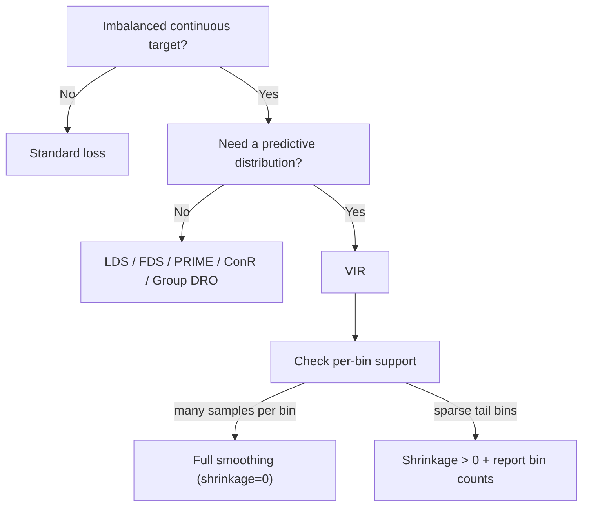

# Variational Imbalanced Regression (VIR)

> ← [Continuous Group DRO](group_dro.md) | [Algorithms overview](../index.md) → [Methods overview](../index.md)

Standard regression on a long-tailed target fails in two ways at once: the bulk of the labels dominates the objective (so the rare tails are under-fitted), and a deterministic model gives no honest uncertainty estimate exactly where it is least reliable. **Variational Imbalanced Regression (VIR)** (Wang & Wang, NeurIPS 2023) addresses both in a single model. It learns a *probabilistic* latent representation whose per-bin statistics are smoothed across **neighbouring labels**, and it predicts a full **Normal–Inverse–Gamma (NIG)** distribution whose pseudo-counts are reweighted by the *smoothed label density*.

This sits alongside output reweighting ([LDS](../../losses/imbalanced.md)), feature-statistic smoothing ([FDS](../../losses/imbalanced.md)), representation learning ([PRIME & ConR](../../losses/prime_conr.md)), and worst-regime training ([Continuous Group DRO](group_dro.md)). Its distinguishing feature is that the output is a **predictive distribution**, not only a point estimate.

!!! abstract "The idea in one paragraph"
    Encode $x_i$ into a diagonal Gaussian $q_\phi(z_i\mid x_i)$. For every label bin, estimate the *statistics of the statistics* — the mean of the latent means, the variance of the latent means, and the mean of the latent variances — smooth them over neighbouring bins, and whiten/recolour each representation. Feed the recoloured representation to an NIG head that emits a pseudo-count, a location, and a scale. Multiply the pseudo-count by $w_i=\tilde p_{b(i)}^{-1/2}$ from the smoothed label density so rare labels receive more evidence, and train with the Student-t marginal NLL plus an evidential regulariser.

---

## Why both a representation and a distribution?

- **Output reweighting alone** ([LDS](../../losses/imbalanced.md), density weighting) changes the loss but leaves the hidden representation of a rare label dominated by the bulk. A mini-batch with no tail object still produces no tail gradient.
- **Feature smoothing alone** ([FDS](../../losses/imbalanced.md)) borrows first/second moments across neighbouring label bins, but the model is still deterministic: there is no predictive distribution to inspect in the tail.
- **Evidential regression alone** ([DER](../../losses/advanced.md)) predicts an NIG distribution but is designed for the balanced regime; on imbalanced data the tail evidence is unstable and the NIG parameters can be poorly estimated.
- **VIR** couples the two: the representation of a rare label borrows statistics from nearby labels, and the evidential pseudo-count is enlarged for rare labels so the likelihood focuses there. The result is a single-forward-pass predictive distribution.

!!! info "What this implementation is (and is not)"
    This is the **discriminative core** of VIR: probabilistic representation, neighbouring-label smoothing, reweighted NIG head, and Adam training. The paper's full variational objective also contains an input-reconstruction term $\mathbb E_q[\log p_\theta(x\mid z)]$ and a KL term. The reconstruction decoder is task-specific and is omitted here; a small optional KL weight on the latent representation keeps its scale stable in the decoder's absence. The uncertainty is therefore the **NIG predictive uncertainty** (aleatoric plus evidential epistemic), not a Bayesian posterior over network weights.

---

## Mathematical formulation

### Notation and label bins

Let $\{(x_i,y_i)\}_{i=1}^N$ be the training set and partition the target range into $B$ equal-width bins with edges $e_0<\dots<e_B$ and centres $c_b=(e_{b-1}+e_b)/2$. Write $b(i)$ for the bin of $y_i$ and $N_b$ for its population. Bins are half-open, $[e_b,e_{b+1})$; out-of-range values are clamped into the boundary bins.

### Probabilistic representation

A feature encoder maps $x_i$ to features, and a linear head emits a diagonal Gaussian

$$q_\phi(z_i\mid x_i)=\mathcal N\!\left(z_i;\,z_i^\mu,\,\operatorname{diag}(z_i^\Sigma)\right),\qquad z_i^\Sigma>0 .$$

The *N.I.D.* assumption replaces the usual I.I.D. assumption: a representation may be calibrated using data with similar labels, not only its own input.

### Statistics of the statistics

For each bin, VIR computes three quantities. The mean of the latent means and the variance of the latent means are

$$\mu_b^\mu=\frac{1}{N_b}\sum_{i\in b}z_i^\mu,\qquad
\mu_b^\Sigma=\frac{1}{N_b^2}\sum_{i\in b}z_i^\Sigma .$$

The expected within-bin covariance follows from the law of total variance, with the variance of the bin mean subtracted:

$$\Sigma_b^\mu=\frac{1}{N_b}\sum_{i\in b}\left[z_i^\Sigma+(z_i^\mu)^2\right]-\mu_b^\Sigma-(\mu_b^\mu)^2 .$$

### Neighbouring-label smoothing

A symmetric Gaussian kernel $k(c_b,c_{b'})=\exp\!\big(-(c_b-c_{b'})^2/(2\sigma^2)\big)$ is row-normalised. Empty bins carry no information and are **excluded** from each row before normalisation; otherwise their global-mean imputation would drag the extreme bins toward the bulk. The smoothed statistics are

$$\tilde\mu_b^\mu=\sum_{b'}k_{bb'}\,\mu_{b'}^\mu,\qquad
\tilde\Sigma_b^\mu=\sum_{b'}k_{bb'}\,\Sigma_{b'}^\mu,\qquad
\tilde\mu_b^\Sigma=\sum_{b'}\bar k_{bb'}^{\,2}\,\mu_{b'}^\Sigma,$$

where $\bar k^{\,2}$ is the squared kernel renormalised over occupied bins (the variance of a weighted mean is the sum of squared weights).

### Probabilistic whitening and recolouring

Each representation is whitened with its own bin's statistics and recoloured with the smoothed ones:

$$\tilde z_i^\mu=(z_i^\mu-\mu_b^\mu)\sqrt{\frac{\tilde\Sigma_b^\mu}{\Sigma_b^\mu}}+\tilde\mu_b^\mu,\qquad
\tilde z_i^\Sigma=(z_i^\Sigma+\mu_b^\Sigma)\sqrt{\frac{\tilde\Sigma_b^\mu}{\Sigma_b^\mu}}+\tilde\mu_b^\Sigma .$$

The scale ratio is clamped to $[0.1,10]$ for numerical stability. A count-dependent shrinkage

$$\alpha_b=\frac{N_b}{N_b+\kappa},\qquad
z_i^{\text{used}}=(1-\alpha_b)\,z_i+\alpha_b\,\tilde z_i$$

protects singleton and very sparse bins: the paper assumes enough samples per bin for the within-bin covariance to be meaningful, while a catalog tail often has only a handful. Set `smoothing_shrinkage=0` to recover the paper's full recolouring.

During training, $z_i\sim\mathcal N(\tilde z_i^\mu,\operatorname{diag}(\tilde z_i^\Sigma))$ is reparameterised before the NIG head. The statistics are treated as constants and recomputed from the current encoder at the start of each epoch.

### Reweighted NIG posterior

The smoothed label density is $\tilde p_b=\sum_{b'}k_{bb'}\hat p_{b'}$, and the importance weight is

$$w_i=\min\!\left(\tilde p_{b(i)}^{-1/2},\,w_{\max}\right).$$

A linear head emits a raw pseudo-count $n_i^{\text{raw}}$, a location $\psi_i$, and a raw scale $\phi_i^{\text{raw}}$. They are constrained as

$$n_i=\operatorname{softplus}(n_i^{\text{raw}})+n_{\min},\qquad
\phi_i=\operatorname{softplus}(\phi_i^{\text{raw}})+\phi_{\min},$$

with $n_{\min}=2$ following the paper. Given the prior $\mathrm{NIG}(\gamma_0,\nu_0,\alpha_0,\beta_0)$, the reweighted posterior parameters are

$$\nu_i^*=\nu_0+w_i n_i,\qquad
\gamma_i^*=\frac{\gamma_0\nu_0+w_i n_i\psi_i}{\nu_i^*},\qquad
\alpha_i^*=\alpha_0+\tfrac12 w_i n_i,\qquad
\beta_i^*=\beta_0+\tfrac12\gamma_0^2\nu_0+\phi_i .$$

Because $w_i$ grows as the smoothed density falls, a rare label receives a larger pseudo-count and therefore a larger weight in the likelihood. This is the *probabilistic reweighting* mechanism; it is the NIG analogue of inverse-density weighting, not a post-hoc multiplication of the loss.

### Objective

Marginalising the Gaussian likelihood over the NIG prior gives a Student-t predictive

$$y_i\sim t_{2\alpha_i^*}\!\left(\gamma_i^*,\ \frac{\beta_i^*(1+\nu_i^*)}{\alpha_i^*\nu_i^*}\right).$$

Its negative log-likelihood is

$$\mathcal L_i^{\mathrm{NLL}}
=\tfrac12\log\frac{\pi}{\nu_i^*}
-\alpha_i^*\log\Omega_i
+\left(\alpha_i^*+\tfrac12\right)\log\!\left((y_i-\gamma_i^*)^2\nu_i^*+\Omega_i\right)
+\log\frac{\Gamma(\alpha_i^*)}{\Gamma(\alpha_i^*+\tfrac12)},$$

with $\Omega_i=2\beta_i^*(1+\nu_i^*)$. The training objective adds the evidential regulariser of the paper,

$$\mathcal L_i=\mathcal L_i^{\mathrm{NLL}}+\lambda\,(\nu_i^*+2\alpha_i^*)\,|y_i-\gamma_i^*|,$$

and optionally a small $\mathrm{KL}\big(q_\phi(z_i\mid x_i)\,\|\,\mathcal N(0,I)\big)$ term scaled by `kl_weight`.

### Prediction

The predictive mean is $\hat y_i=\gamma_i^*$. The total predictive variance of the Student-t is

$$\operatorname{Var}(y_i)=\frac{\beta_i^*(1+\nu_i^*)}{\nu_i^*(\alpha_i^*-1)},$$

which is the sum of the aleatoric and evidential epistemic variances. `predict(..., return_std=True)` returns the square root of this quantity; `predict_interval(...)` uses the exact Student-t quantiles with $2\alpha_i^*$ degrees of freedom.

---

## Algorithm

1. **Fit label statistics.** Bin the training targets, estimate $\hat p_b$, smooth the density, and store $w_b=\tilde p_b^{-1/2}$ and the bin edges.
2. **Warm-up epoch.** Train with the raw representation (identity recolouring). The first per-bin statistics are collected at the start of the second epoch.
3. **Epoch loop (from epoch 2).**
   1. Refresh $(\mu_b^\mu,\mu_b^\Sigma,\Sigma_b^\mu)$ and the smoothed counterparts from the current encoder on the full training set (no gradient).
   2. For each mini-batch: encode, recolour with the start-of-epoch statistics, reparameterise, and evaluate the NIG head.
   3. Minimise $\mathcal L_i$ with Adam, adding the optional KL regulariser.
4. **Inference.** Encode the test point; a first pass gives an initial label, its bin selects the stored training statistics, and the recoloured representation gives the final NIG posterior. The density weight is evaluated at the model's own predicted label, so **no test labels are used**. `n_refine` controls how many times the bin is refreshed.

---

## Usage

### End-to-end regressor

```python
import torch
import torch.nn as nn

from torchregress.algorithms import VIRRegressor

torch.manual_seed(0)
y = torch.cat([0.4 * torch.randn(500), 2.5 * torch.randn(50)])
X = torch.stack([torch.sin(y), torch.cos(y)], dim=1) + 0.05 * torch.randn(len(y), 2)

encoder = nn.Sequential(nn.Linear(2, 32), nn.SiLU(), nn.Linear(32, 32))

regressor = VIRRegressor(
    encoder,
    n_bins=12,
    kernel_sigma=1.0,          # bandwidth in bin-width units
    smoothing_shrinkage=10.0,  # protects sparse tail bins
    reg_weight=0.01,           # lambda in the evidential regulariser
    epochs=60,
    batch_size=64,
    lr=1e-3,
    seed=0,
)
regressor.fit(X, y)

mean, std = regressor.predict(X[:5], return_std=True)
lower, upper = regressor.predict_interval(X[:5], confidence=0.9)
print(mean.shape, std.shape, lower.shape, upper.shape)
```

The fitted attributes are:

| Attribute | Meaning |
|:----------|:--------|
| `model_` | Fitted encoder + probabilistic latent head + NIG head, in `eval` mode. |
| `loss_fn_` | Fitted `VIRLoss`, including the label bins and smoothed density. |
| `history_` | One dict per epoch with the mean batch loss. |
| `bin_counts_` | Training sample count per label bin. |
| `bin_mean_`, `bin_cov_`, `bin_mean_var_` | Per-bin $\mu_b^\mu$, $\Sigma_b^\mu$, $\mu_b^\Sigma$. |
| `smoothed_bin_mean_`, `smoothed_bin_cov_`, `smoothed_bin_mean_var_` | Kernel-smoothed counterparts used for recolouring. |

### The loss in a custom loop

`VIRLoss` consumes the **raw** output of a 3-unit head (it applies the softplus constraints itself). It is a `DistributionLoss`, so it follows the shared `(y_pred, target, mask, weights)` contract:

```python
from torchregress.algorithms import VIRLoss

loss_fn = VIRLoss(
    prior=(0.0, 1.0, 2.0, 0.1),
    reg_weight=0.01,
    n_bins=20,
    kernel_sigma=1.0,
    max_importance_weight=10.0,
).fit(y_train)                      # estimates the smoothed label density

for x, y in loader:
    z, _ = encoder(x)
    raw = nig_head(z)               # (N, 3): raw_n, psi, raw_phi
    loss = loss_fn(raw, y)          # reweighted NIG NLL + regulariser
    loss.backward()
    optimizer.step()
```

The loss also exposes `posterior_parameters(raw, importance_weight=None)` and `predictive_mean_std(posterior)` for inspection; before `fit()` the importance weights are all one and the loss is a plain DER-style evidential NLL.

### Full runnable comparison

The following example trains a plain-MSE baseline and VIR on a deliberately imbalanced, ordered-target regression problem. It compares the rare-tail error and the empirical coverage of 90 % intervals. Every call matches the signatures above.

```python
import torch
import torch.nn as nn

from torchregress.algorithms import VIRRegressor


def make_data(n, seed, probabilities=(0.02, 0.08, 0.80, 0.08, 0.02)):
    """Five ordered target values, with an optional balanced test distribution."""
    generator = torch.Generator().manual_seed(seed)
    classes = torch.tensor([-2.0, -1.0, 0.0, 1.0, 2.0])
    probability = torch.tensor(probabilities)
    targets = classes[torch.multinomial(probability, n, replacement=True, generator=generator)]
    direction = torch.tensor([1.0, 0.2, -0.3, 0.4, 0.1, -0.2, 0.3, 0.5])
    features = 1.5 * targets.unsqueeze(1) * direction + 0.8 * torch.randn(
        n, direction.numel(), generator=generator
    )
    return features, targets.unsqueeze(1)


def make_encoder(n_features, hidden=32):
    return nn.Sequential(
        nn.Linear(n_features, hidden),
        nn.SiLU(),
        nn.Linear(hidden, hidden),
        nn.SiLU(),
    )


torch.manual_seed(0)
X_train, y_train = make_data(2000, seed=0)
X_test, y_test = make_data(1000, seed=99, probabilities=(0.2, 0.2, 0.2, 0.2, 0.2))
tail = y_test.abs().squeeze(1) >= 1.0

# Plain-MSE baseline: same encoder architecture, optimiser and training budget.
torch.manual_seed(0)
encoder = make_encoder(X_train.shape[1])
baseline = nn.Sequential(make_encoder(X_train.shape[1]), nn.Linear(32, 1))
with torch.no_grad():
    baseline[0].load_state_dict(encoder.state_dict())
optimizer = torch.optim.Adam(baseline.parameters(), lr=3e-3)
generator = torch.Generator().manual_seed(1)
for _ in range(120):
    baseline.train()
    order = torch.randperm(len(X_train), generator=generator)
    for start in range(0, len(X_train), 64):
        index = order[start : start + 64]
        optimizer.zero_grad(set_to_none=True)
        ((baseline(X_train[index]) - y_train[index]) ** 2).mean().backward()
        optimizer.step()
baseline.eval()
with torch.no_grad():
    mse_prediction = baseline(X_test)
    residual_std = (baseline(X_train) - y_train).std()
mse_tail = (mse_prediction - y_test).abs()[tail].mean()
mse_coverage = ((y_test - mse_prediction).abs() <= 1.645 * residual_std).float().mean()

# VIR: same encoder weights, probabilistic smoothing and reweighted NIG head.
vir = VIRRegressor(
    encoder,
    n_bins=10,
    kernel_sigma=1.0,
    smoothing_shrinkage=10.0,
    epochs=120,
    lr=3e-3,
    batch_size=64,
    seed=0,
)
vir.fit(X_train, y_train)
vir_prediction, vir_std = vir.predict(X_test, return_std=True)
lower, upper = vir.predict_interval(X_test, confidence=0.9)
vir_tail = (vir_prediction - y_test).abs()[tail].mean()
vir_coverage = ((y_test >= lower) & (y_test <= upper)).float().mean()

print(f"plain MSE : tail MAE={mse_tail:.3f}  90% coverage={mse_coverage:.3f}")
print(f"VIR       : tail MAE={vir_tail:.3f}  90% coverage={vir_coverage:.3f}")
```

Typical output on CPU with these seeds:

```text
plain MSE : tail MAE≈0.50  90% coverage≈0.57
VIR       : tail MAE≈0.41  90% coverage≈0.75
```

Both models are deterministic for the given seeds. The absolute numbers are not the point: the ordered rare targets are systematically under-predicted by plain MSE, and the single global residual standard deviation is badly calibrated, while VIR's per-sample evidential scale is closer to nominal.

---

## When to use VIR



| Method | Level | Mechanism | Predictive uncertainty | Needs target bins? | Main weakness |
|:-------|:------|:----------|:----------------------|:-------------------|:--------------|
| Plain MSE | Output loss | Mean squared error | No (post-hoc only) | No | Bulk dominates; tail bias |
| [LDS](../../losses/imbalanced.md) | Output loss | Kernel-smoothed label density reweighting | No | Yes | Can break calibration; no representation change |
| [FDS](../../losses/imbalanced.md) | Feature statistics | Kernel-smoothed feature mean/variance | No | Yes | Deterministic; no predictive distribution |
| [PRIME](../../losses/prime_conr.md) | Representation | Per-bin proxy features | No | Implicitly (bins) | Extra proxies; no UQ |
| [ConR](../../losses/prime_conr.md) | Representation | Contrastive order-preserving regulariser | No | No | Pairwise cost; no UQ |
| [Group DRO](group_dro.md) | Output loss | Worst-regime reweighting | No | Yes (physical bins) | Equalises regimes, not samples |
| **VIR** | Representation + output | Probabilistic smoothing + reweighted NIG | **Yes, single pass** | Yes | Needs per-bin support; evidential calibration is approximate |

!!! tip "Choosing the number of bins and the bandwidth"
    Use **equal-width** bins, as the paper does: the kernel is defined on label distance, and equal-size bins would make $k(y_b,y_{b'})$ depend on the bin population rather than on physical distance. The bandwidth `kernel_sigma` is measured in **bin widths**, so it is independent of the target range. With $B$ bins, the number of samples per bin scales as $N/B$; in the tail, check `bin_counts_` before trusting the recolouring. The count shrinkage `smoothing_shrinkage` is the practical knob for sparse bins: $\kappa=0$ is the paper's full recolouring, larger values fall back toward the raw representation.

---

## Caveats and failure modes

!!! warning "This is the discriminative core, not the full VAE"
    The input-reconstruction term of the paper's ELBO is not implemented. Consequently the latent space is regularised only by the predictive loss and the optional `kl_weight`, not by a decoder. Two practical consequences: (i) the latent scale can drift if `kl_weight=0` and the encoder is large; (ii) the "variational" uncertainty reported here is the **NIG predictive** uncertainty, not a posterior over encoder weights. Use ensembles or a Bayesian last layer if you need model-uncertainty decomposition.

!!! warning "Smoothing helps only when neighbouring labels are statistically similar"
    The recolouring removes the between-bin component of the representation and replaces it with the kernel-smoothed mean. This is beneficial when the target is effectively constant within a bin (the paper's age/score regression setting), but it can *hurt* fine-grained interpolation where the within-bin variation carries most of the signal. In that regime use a larger `smoothing_shrinkage` (or `n_bins` fine enough that the signal is between bins) and let the reweighted NIG head do the work. The synthetic test in `tests/algorithms/test_vir.py` deliberately uses ordered discrete targets where smoothing is meaningful.

!!! warning "Empty and singleton bins"
    The implementation excludes empty bins from the kernel and blends the recoloured representation with the raw one by $N_b/(N_b+\kappa)$. Without these safeguards, a singleton tail bin collapses onto its neighbours' mean and the tail predictions degrade sharply. Always inspect `bin_counts_`; if a physically important bin has only a few samples, merge bins or increase shrinkage.

!!! warning "Calibration is not guaranteed"
    Evidential regression is known to under-cover when the model is misspecified or the tail is far from the training density. In the synthetic example above, VIR's 90 % intervals cover about 75 % (plain MSE: about 57 %), so VIR is *better* but still not nominal. Do not report 90 % coverage without checking it on held-out data; combine with [conformal prediction](../../methods/conformal/index.md) if a finite-sample coverage guarantee is required.

!!! info "Test-time two-pass inference"
    At test time the true bin is unknown. The default `inference_smoothing="two_pass"` predicts a label, uses its bin to select the stored statistics, recolours, and re-predicts; `n_refine` refreshes the bin. The density weight is evaluated at the predicted label. This is a plug-in procedure, not a Bayesian marginalisation over bins; if the first-pass prediction is badly wrong, the recolouring uses the wrong bin. `inference_smoothing="none"` avoids the extra pass but creates a train/test mismatch because the NIG head was trained on recoloured features.

!!! info "Scope and determinism"
    Only a single scalar output is supported: a multi-output target needs one NIG head per output. Non-finite inputs and targets are rejected (this is not a missing-data loss). With a deterministic encoder, `seed` makes `fit` reproducible and keeps the global RNG untouched; an encoder with dropout uses the global RNG and is not made deterministic by `seed`.

---

## References

| # | Reference |
|:-:|:----------|
| 1 | Wang, Z., & Wang, H. (2023). Variational Imbalanced Regression: Fair Uncertainty Quantification via Probabilistic Smoothing. *NeurIPS 2023*. [arXiv:2306.06599](https://arxiv.org/abs/2306.06599) |
| 2 | Amini, A., Schwarting, W., Soleimany, A., & Rus, D. (2020). Deep Evidential Regression. *NeurIPS 2020*. [arXiv:1910.02600](https://arxiv.org/abs/1910.02600) |
| 3 | Yang, Y., Zha, K., Chen, Y.-C., Wang, H., & Katabi, D. (2021). Delving into Deep Imbalanced Regression (LDS/FDS). *ICML 2021*. [arXiv:2102.09554](https://arxiv.org/abs/2102.09554) |
| 4 | Sagawa, S., Koh, P. W., Hashimoto, T. B., & Liang, P. (2020). Distributionally Robust Neural Networks for Group Shifts. *ICLR 2020*. [arXiv:1911.08731](https://arxiv.org/abs/1911.08731) |
| 5 | Lim, J., Lee, S., Um, D., Park, S.-U., & Shin, J. (2025). PRIME: Deep Imbalanced Regression with Proxies. *ICML 2025*. [Poster](https://icml.cc/virtual/2025/poster/44388) |
| 6 | Keramati, M., Meng, L., & Evans, R. D. (2024). ConR: Contrastive Regularizer for Deep Imbalanced Regression. *ICLR 2024*. [arXiv:2309.06651](https://arxiv.org/abs/2309.06651) |

## See also

- [`VIRRegressor` / `VIRLoss` API](../../api/algorithms.md#variational-imbalanced-regression-vir)
- [Imbalanced regression losses](../../losses/imbalanced.md) — LDS, FDS, Balanced MSE, Focal-R, density weighting.
- [Evidential regression](../../losses/advanced.md) — the NIG head and its uncertainty decomposition.
- [PRIME & ConR](../../losses/prime_conr.md) — representation-level alternatives without predictive uncertainty.
- [Continuous Group DRO](group_dro.md) — worst-regime rather than worst-sample robustness.
- [Forward generative inversion](forward_inversion.md) — another route to tail-aware regression when features are noisier than labels.
- [Method selection](../../guide/method-selection.md) — task-level guidance.
