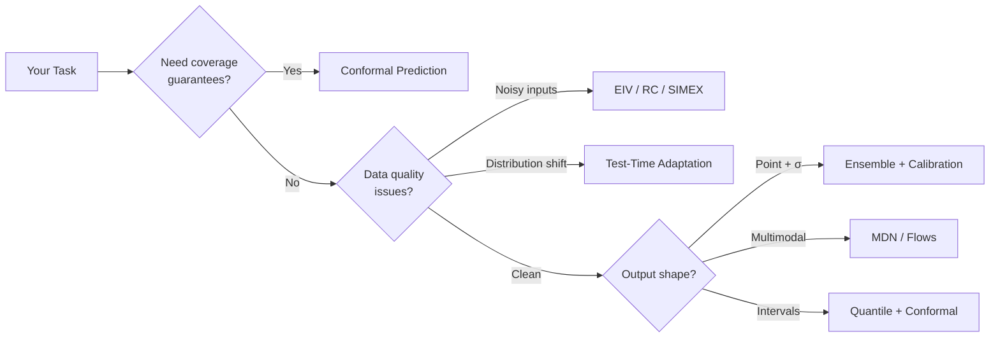

# Methods

While [loss functions](../losses/index.md) define *what* your model
optimizes, the **methods** in this section define *how* to extract reliable
uncertainty, correct for data issues, and validate your results.

Use the taxonomy below to find the right method for your task, or read each
section in order — the flow goes from most commonly needed (conformal,
ensembles) to more specialized tools (causal inference, PPI).

## Three questions every method answers

Beyond the loss function, a regression method is defined by which part of the predictive distribution it identifies and what it guarantees:

1. **What is the forecast object?** A point $\hat{y}(x)$, an interval $[L(x), U(x)]$, a density $p_\theta(y \mid x)$, or a set of members $\{y^{(m)}(x)\}$.
2. **Where does the uncertainty come from?** Aleatoric noise is the conditional spread of $Y$ given $x$; epistemic uncertainty is uncertainty about the model itself. Their sum is the predictive variance
   $$
   \operatorname{Var}(Y \mid x, \mathcal{D}) = \underbrace{\mathbb{E}_{\theta \mid \mathcal{D}}\big[\operatorname{Var}(Y \mid x, \theta)\big]}_{\text{aleatoric}} + \underbrace{\operatorname{Var}_{\theta \mid \mathcal{D}}\big[\mathbb{E}(Y \mid x, \theta)\big]}_{\text{epistemic}}.
   $$
3. **What is the guarantee?** Some methods are purely empirical (a better-trained variance head); others carry a finite-sample statement, e.g.
   $$
   P\big(Y_{n+1} \in \hat{C}(X_{n+1})\big) \ge 1-\alpha
   $$
   for conformal prediction under exchangeability, or asymptotic normality for the doubly-robust causal estimators.

Keeping those three questions separate prevents the most common category error in practice: treating a *coverage* guarantee as an *epistemic* decomposition, or treating ensemble disagreement as a calibrated density. The [uncertainty-decomposition guide](../guide/uncertainty-decomposition.md) states exactly which contracts each family does and does not satisfy.

---

## Method Taxonomy

---

## Sections

### [Conformal Prediction](conformal/index.md)

Distribution-free prediction intervals with **finite-sample coverage
guarantees**. Wrap any pre-trained model for calibrated intervals —
Split conformal (fast baseline), CQR (heteroscedastic), CTI (multimodal),
and density-aware variants. **Start here if you need coverage guarantees.**

### [Ensembles for Uncertainty](ensemble/index.md)

Deep Ensembles, BatchEnsemble, SWAG, MC-Dropout, BNN — epistemic uncertainty
via member disagreement; aleatoric decomposition when members predict variance
(e.g. `HeteroscedasticEnsembleModel`). **Start here if you need to know what
the model doesn't know.**

### [Algorithms](algorithms/irls.md)

Specialized training algorithms: [IRLS](algorithms/irls.md) for robust
fitting, [RC](algorithms/rc.md) and [SIMEX](algorithms/simex.md) for
measurement error correction, [TIC-TAC](algorithms/tictac.md) for covariance
learning, [Heteroscedastic Laplace](algorithms/heteroscedastic_laplace.md)
for last-layer Bayesian regression, and
[Adaptive Prior VI](algorithms/adaptive_prior_vi.md) for covariate-shift
robustness, [VIR](algorithms/vir.md) for imbalanced targets with evidential
uncertainty, and [Continuous Group DRO](algorithms/group_dro.md) for
worst-regime robustness. **Start here if standard training isn't enough for your data.**

### [Test-Time & Shift](test-time/bayesian-linear-regression.md)

Adapt models at deployment without retraining: Bayesian linear heads for
closed-form posterior updates, OT-based conformal reweighting for covariate
shift, and shift-factored predictive transport. **Start here if your test
distribution differs from training.**

### [Tabular MLP](tabular_mlp.md)

A strong-default neural backbone for tabular data (robust scaling, periodic
embeddings, AdamW with early stopping) that works with any torchregress loss
head. **Start here if you need a well-tuned network without a tuning loop.**

### [Model-Agnostic UQ Wrappers](estimators.md)

Conformal intervals (split, normalized, CQR, CV+, Jackknife+) and variance
calibration on top of any scikit-learn, LightGBM, torch or `TabularFit` base,
plus a one-call calibrated deep-ensemble recipe. Experimental in 0.3, may change
in 0.4. **Start here if you already have a good point model and need intervals.**

### [Post-Hoc Calibration](calibration.md)

Improve uncertainty quality after training: variance temperature scaling,
isotonic mean calibration, PIT calibration. One-line API, no retraining
needed. **Always calibrate before trusting your intervals.**

### [Constraints](constraints.md)

Enforce structural properties on model outputs: non-negativity, bounded
ranges, simplex, monotonic quantile curves, Lipschitz bounds. Drop-in
`nn.Module` wrappers. **Start here if your domain requires hard output
constraints.**

### [Causal Inference](causal.md)

Doubly-robust ATE / CATE estimation with cross-fitting and overlap
diagnostics. **Start here if you need treatment-effect estimates under
confounding.**

### [Prediction-Powered Inference](inference.md)

Confidence intervals under limited labels — combine a small trusted-labeled
set with a large model-predicted pool for efficient statistical inference.
**Start here if you have abundant unlabeled data but scarce labels.**

### [Semi-Supervised Regression](semi_supervised.md)

Teacher–student consistency with distributional pseudo-labels: an EMA teacher
builds a consensus predictive batch on unlabeled inputs, and the student is
penalised for disagreeing with it. **Start here if labels are scarce but
unlabeled inputs are abundant.**

### [Flow Matching & Normalizing Flow Maps](flow_matching.md)

Simulation-free conditional generation with a learned velocity field
([flow matching](flow_matching.md)) and two-time invertible pushforwards with
exact endpoint likelihoods ([flow maps](normalizing_flow_maps.md)). **Start
here when you need multimodal conditional samples rather than a parametric
density.**

### [WALDO Wald Regions](waldo.md)

Simulator-free confidence regions for regression parameters from predictive
mean and covariance, with a critical-value regressor calibrated on held-out
data. **Start here when you want parameter confidence sets rather than
prediction intervals.**

### [Visualization](visualization.md)

Diagnostic plots for calibration, residuals, learning curves, and method
comparisons. **Start here when you want to visually validate your model's
behavior.**

---

## Next steps

- [Loss Functions catalogue](../losses/index.md) — every loss with formulas
- [Method Selection Matrix](../guide/method-selection.md) — task-first capability matrix
- [Metrics](../metrics/index.md) — evaluate your results rigorously
